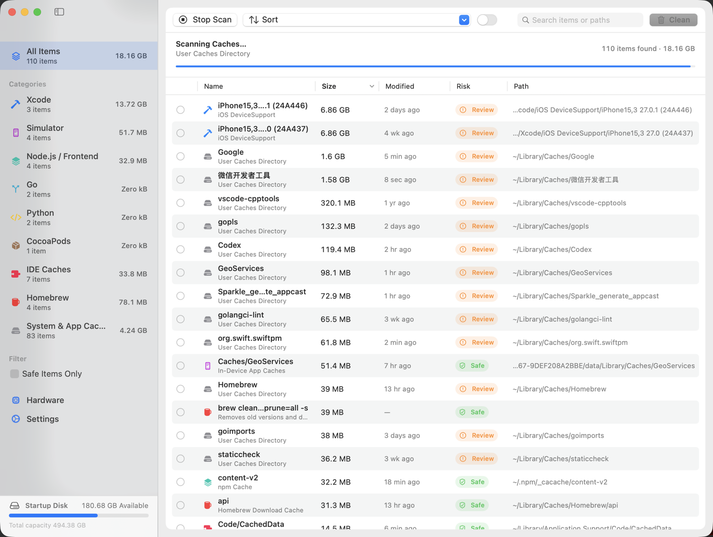

<div align="center">


# Mackit

**Un limpiador de caché para desarrolladores en macOS** — escanea todas las cachés regenerables que deja tu cadena de herramientas, elige los elementos uno por uno con etiquetas de riesgo claras y recupera tu espacio en disco.

[](https://www.apple.com/macos/)
[](https://www.swift.org/)
[](LICENSE)
[](https://github.com/virskor/mackit/releases)
[](https://github.com/virskor/mackit/releases)

[Español](README_ES.md) · [English](README.md) · [简体中文](README_ZH.md) · [繁體中文](README_ZH_HANT.md) · [한국어](README_KO.md) · [日本語](README_JA.md) · [Русский](README_RU.md) · [Français](README_FR.md)

🌐 [Sitio web oficial](https://www.mingcui.cn) · ⬇️ [Descargar](https://www.mingcui.cn/download/mackit)

</div>

---

## Por qué Mackit

Go, Node, Yarn, pnpm, Dart, Flutter, Rust, Python, CocoaPods, Gradle, Xcode, Android Studio… cada una de estas herramientas deja en tu Mac **cachés regenerables**: descargas de paquetes, artefactos intermedios de compilación, cachés de módulos, datos de simuladores, índices de herramientas. Ninguna parece grande por sí sola; juntas suman decenas de gigabytes. Y en el Finder se esconden repartidas en una docena de carpetas ocultas (las que empiezan por punto), donde no puedes ver su tamaño ni eliminarlas con seguridad.

Lo que hace Mackit:

1. **Escanear** — enumera en paralelo más de 60 reglas para encontrar cachés, artefactos de compilación y archivos residuales dondequiera que estén, transmitiendo los resultados de modo que los tamaños aparecen mientras el escaneo aún está en curso;
2. **Etiquetar** — cada elemento lleva un nivel de riesgo (Seguro / Revisar / Precaución) y su ruta completa, para que sepas qué ocurre antes de eliminar;
3. **Elegir** — nada está marcado de forma predeterminada; eliges elemento por elemento, o seleccionas todos los elementos «seguros» de una sola vez;
4. **Eliminar** — mover a la papelera (reversible) o eliminar de forma permanente; los elementos de línea de comandos invocan los comandos de limpieza propios de cada herramienta.

## Características

- **Escaneo con un solo clic**: 77 reglas de rutas + 13 reglas de limpieza por línea de comandos, transmitidas a la lista mientras el escaneo aún está en curso
- **Tres niveles de riesgo**: `Seguro` (caché pura, recreada por la herramienta) / `Revisar` (hay que volver a descargarla o recompilarla) / `Precaución` (Papelera, copias de seguridad de iOS, etc. — requiere confirmación adicional)
- **Desinstalación de apps**: una página de herramientas (sección «Herramientas» de la barra lateral) que lista las apps instaladas en `/Applications` y `~/Applications` junto con sus archivos residuales en `~/Library` (soporte de aplicaciones, cachés, contenedores, preferencias, elementos de inicio de sesión…), permitiendo desinstalar una app junto con sus residuales o limpiar solo los residuales; las apps en ejecución se rechazan
- **Limpieza de basura de apps**: el escaneo de limpieza cubre la parte regenerable de los archivos residuales de una app (cachés, almacenamientos HTTP, datos de WebKit, registros, informes de fallos) en la fila «Basura de apps» de la limpieza general — por app, de modo que puedes conservar las cachés de una app mientras limpias las del resto
- **Escaneo de artefactos de compilación**: apunta a una carpeta (p. ej. `~/Projects`) para encontrar `node_modules`, `build`, `Pods`, `.dart_tool`, `DerivedData`, `target`, `.venv` y otras carpetas reconstruibles
- **Limpieza por línea de comandos**: `go clean -cache`, `npm cache clean`, `brew cleanup`, `dart pub cache clean`, etc.
- **Panel en la barra de menús**: un icono residente en la barra de menús abre un panel con el espacio recuperable, CPU / memoria / temperatura, ranking de memoria por app con «Liberar memoria» de un solo clic, espacio libre en disco y un gráfico de CPU
- **Ventana flotante de estadísticas en el escritorio**: una barra opcional siempre al frente que muestra CPU / memoria / temperatura de forma compacta, legible sobre cualquier fondo de pantalla, arrastrable y con memoria de posición, que vive solo en el proceso de la bandeja
- **Análisis de espacio en disco**: una página de herramientas (sección «Herramientas» de la barra lateral, debajo de las entradas de limpieza) que responde «a dónde se fue el espacio» — desglose con migas de pan desde el disco de arranque, el tamaño recursivo de cada carpeta y un treemap del desglose de la carpeta seleccionada
- **Información de hardware**: modelo, discos, batería y otra información estática
- **Interfaz nativa**: barra lateral + tabla + barra de herramientas en SwiftUI con menús contextuales nativos, atajos de teclado, búsqueda y cabeceras de columna que se ordenan al hacer clic
- **Localizado**: chino simplificado / inglés / chino tradicional / coreano / japonés / ruso / español / francés; sigue el idioma del sistema de forma predeterminada
- **Salvaguardas**: lista integrada de rutas protegidas; los directorios del sistema y el llavero siempre se rechazan

## Captura de pantalla



> Las capturas del panel de la barra de menús, la ventana flotante de escritorio y la página de hardware aún están por llegar.

## Instalación

### Descargar un binario precompilado (recomendado)

⬇️ [Descargar Mackit](https://www.mingcui.cn/download/mackit)

Obtén el DMG más reciente de [Releases](https://github.com/virskor/mackit/releases), ábrelo y arrastra Mackit a Aplicaciones.

- Binario universal (arm64 + x86_64) tanto para Macs con Apple silicon como para Macs con Intel
- Requiere macOS 14 o posterior (los equipos Intel deben poder ejecutar macOS 14)
- La primera instalación se hace mediante DMG; las actualizaciones posteriores, mediante la actualización automática de Sparkle integrada en la app

### Compilar desde el código fuente

Requiere macOS 14+ y Xcode 16+ (Swift 6):

```bash
git clone https://github.com/virskor/mackit.git
cd mackit

# Opción 1: compilar y lanzar en un solo paso (debug, la iteración más rápida)
./run.sh

# Opción 2: compilar el Mackit.app de release y luego lanzarlo
Scripts/build-app.sh release
open Mackit.app
```

También puedes abrir `Package.swift` en Xcode y ejecutar el esquema `Mackit`. Las compilaciones de desarrollo solo compilan para la arquitectura nativa; el binario universal distribuible (arm64 + x86_64) se trata en las [notas de la versión](docs/RELEASE.md).

Ejecuta las pruebas:

```bash
swift test
```

## Uso

1. El primer inicio escanea automáticamente; **nada está marcado de forma predeterminada** — tú decides qué eliminar
2. Explora por categorías en la barra lateral o busca elementos / rutas desde la barra de herramientas
3. Añade tus carpetas raíz de código en «Ajustes › Carpetas de proyectos» para escanear artefactos de compilación como `node_modules`
4. Para desinstalar una app: abre la herramienta «Desinstalación de apps» en la sección «Herramientas» de la barra lateral, marca la app (o expande la fila para marcar archivos residuales individuales) y confirma
5. Tras marcar elementos, haz clic en «Limpiar X GB» en la barra de herramientas; el panel de confirmación muestra los detalles y las notas de riesgo
6. Mantén activada la opción «Mover a la Papelera» y vacía la papelera solo cuando estés seguro

Atajos de teclado:

| Atajo | Acción |
| --- | --- |
| `⌘R` | Escanear de nuevo |
| `⌘⌫` | Limpiar selección |
| `⌘⌥S` | Seleccionar todos los elementos seguros |
| `⌘,` | Ajustes |

## Cobertura

| Categoría | Contenido |
| --- | --- |
| Artefactos de compilación | node_modules, build, Pods, .gradle, .dart_tool, DerivedData, dist, target, .venv, __pycache__, etc. |
| Xcode | DerivedData, Archives, DeviceSupport de iOS/watchOS, DocumentationCache, cachés de módulos |
| Simuladores | cachés de dyld, cachés de apps dentro del dispositivo, carpetas temporales del dispositivo, registros del simulador |
| Android / Gradle | cachés de Gradle, distribuciones del wrapper, registros del daemon, cachés de Android Studio, Kotlin/Native, repositorio de Maven |
| Node / frontend | npm `_cacache`, Yarn, pnpm store, Bun, node-gyp, TypeScript, ESLint, Deno |
| Flutter / Dart | pub-cache (hosted / git / temp), Dart Analysis Server |
| Go | caché de go-build, caché de descarga de módulos |
| Rust | caché/src del registro de cargo, dependencias de git |
| Python | cachés de pip, uv, Poetry, pre-commit |
| Ruby | caché de specs de RubyGems, gems instaladas por el usuario, caché de Bundler |
| PHP | caché de Composer |
| .NET | paquetes globales de NuGet, caché HTTP |
| Scala / JVM | caché de Coursier, arranque de sbt, caché de Ivy |
| Haskell | caché de paquetes y almacén de compilación de Cabal, cadenas de herramientas y snapshots de Stack |
| Clojure | libs de git de tools.deps, instalación de Leiningen |
| Elixir / Erlang | caché del registro de Hex, archivos de Mix, caché de rebar3 |
| Lua | árbol de LuaRocks |
| Julia | caché de precompilación, registros, paquetes instalados |
| OCaml | caché de descarga de opam, índice de paquetes |
| Zig | caché global del compilador |
| Nim | caché del compilador, paquetes de Nimble |
| Crystal | caché del compilador |
| Perl | fuentes de CPAN, residuos de compilación |
| CocoaPods | caché de CocoaPods, caché de Carthage, repos de specs |
| IDEs | cachés y registros de JetBrains, VS Code / Cursor |
| Homebrew | caché de descargas |
| Sistema y apps | `~/Library/Caches`, cachés de apps con sandbox, registros, informes de fallos, copias de seguridad de iOS |
| Papelera | archivos en `~/.Trash` |

Los elementos de limpieza por línea de comandos se agrupan bajo la categoría de su herramienta y se muestran junto a las reglas de rutas correspondientes.

### Desinstalación de apps

La desinstalación de apps es una página de herramientas propia en la sección «Herramientas» de la barra lateral, no parte del escaneo de limpieza: la página lista cada app instalada con su icono real, su versión, su tamaño y su cantidad de archivos residuales; una fila por app con una casilla de tres estados — al marcarla se seleccionan de una vez el bundle de la app y todos sus archivos residuales, y al expandir la fila se revela cada archivo residual con su propia casilla, de modo que una sola caché o archivo de preferencias puede conservarse o eliminarse por separado. Al hacer clic derecho en la fila de una app se ofrecen los dos atajos:

- **Desinstalar con archivos residuales…**: marca la propia app más todos sus archivos residuales y abre la confirmación
- **Limpiar solo archivos residuales…**: limpia los residuales y conserva la app

La desinstalación reutiliza el flujo de limpieza unificado: tanto la app como sus archivos residuales siguen el ajuste «Ajustes › Método de limpieza» — mover a la Papelera (reversible) o eliminar definitivamente. Las apps en ejecución se rechazan, con una nota de resultado que pide salir primero de ellas; el panel de confirmación las nombra por adelantado. Los archivos residuales se etiquetan según su ubicación: las cachés y los registros son «Seguro»; el soporte de aplicaciones, las preferencias, los contenedores y otros lugares que pueden contener datos de usuario son «Revisar».

Si solo se marca la app, el panel de confirmación indica cuántos archivos asociados siguen sin marcar (cantidad y tamaño por app) y ofrece un atajo «Seleccionar todo», para que no acabes con un cascarón vacío de carpeta y las cachés todavía en el disco.

Lo que el escaneo de limpieza conserva del mundo de las apps es la mitad regenerable: la fila «Basura de apps» de la limpieza general barre cachés, almacenamientos HTTP, datos de WebKit, registros e informes de fallos por app — basura que una app reconstruye a demanda — para que puedas liberar ese espacio sin desinstalar nada, y ningún dato de app es alcanzable desde el escaneo de limpieza.

Limitaciones conocidas: los Group Containers (requieren leer los entitlements de cada app), los desinstaladores incluidos en las apps y los LaunchAgents/Daemons de nivel de sistema (necesitan derechos de administrador) no están cubiertos; las apps instaladas en ubicaciones personalizadas descubiertas mediante un escaneo completo con Spotlight también quedan fuera de alcance.

## Permisos

Mackit necesita leer `~/Library`, `~/.pub-cache`, `~/.gradle`, `/Applications` y ubicaciones similares, por lo que **el sandbox de apps no está activado**. Algunas rutas bajo `~/Library` requieren Acceso completo al disco, que el usuario puede conceder manualmente en «Ajustes del Sistema › Privacidad y seguridad › Acceso completo al disco». Abrir una ruta en Terminal solicita el permiso de Apple Events para controlar Terminal (`NSAppleEventsUsageDescription`). «Liberar memoria» en el panel de la bandeja solicita autorización de administrador y ejecuta `purge` (vacía la caché de archivos del disco; no libera la memoria que usan las apps). La herramienta de análisis de disco no entra deliberadamente en `~/Documents`, `~/Desktop` ni `~/Downloads` durante un escaneo — enumerarlos abre el diálogo de acceso del sistema — así que esas carpetas se listan como «sin escanear» y pueden escanearse a demanda (con un clic, o concediendo Acceso completo al disco para un escaneo completo). La CPU, la memoria y la memoria por app provienen de interfaces públicas del sistema (`host_statistics64`, `proc_pid_rusage`); macOS no tiene una API pública de temperatura, así que la temperatura que se muestra es el estado térmico del sistema. Ajustes → General contiene una sección de Permisos que informa en tiempo real de cada uno de estos puntos — si está concedido o no, qué desbloquea, y un botón que abre la fila exacta de ajustes (o, para un consentimiento de automatización que la app nunca ha solicitado, lo pide al sistema — macOS solo lista una app en el panel de Automatización una vez que la app lo ha pedido) — de modo que una función que parece rota puede rastrearse hasta el permiso que la respalda con un solo clic.

## Desarrollo

### Arquitectura: app principal + agente de bandeja

Mackit son dos procesos de un mismo binario, distribuidos en dos bundles que cambian de rol según el bundle ID:

| | Mackit.app (`cn.mingcui.mackit`) | MackitAgent.app (`cn.mingcui.mackit.agent`) |
| --- | --- | --- |
| Forma | normal, con icono en el Dock | LSUIElement, solo en la barra de menús |
| Rol | ventana principal, escaneo, limpieza, ajustes y actualizaciones de Sparkle | icono y panel de la barra de menús, ventana flotante de estadísticas de escritorio, monitorización del sistema |
| Ciclo de vida | termina al cerrar la ventana | residente; un elemento de inicio de sesión lo lanza al iniciar sesión |

**Cerrar la ventana principal = el proceso principal termina = el icono del Dock desaparece, mientras la monitorización de la barra de menús sigue marcando cada minuto** — así se implementa el «ventana cerrada pero la bandeja sigue viva», sin ningún cambio de política de activación en tiempo de ejecución (cambiar entre regular y accessory en tiempo de ejecución hace que macOS reconstruya la barra de menús y añada o quite tiles del Dock cada vez, que es exactamente la razón por la que la barra de menús parpadea y la fila del Dock se desplaza).

Cómo cooperan los dos procesos (`Sources/Mackit/IPC/`):

- **Comandos**: el agente envía notificaciones distribuidas (abrir ventana / ajustes / hardware / limpieza / salir / aviso); si la app principal no está en ejecución, los comandos se persisten primero en disco y se reproducen cuando se lanza (compensación de arranque en frío)
- **Estado**: la app principal difunde el estado de escaneo / limpieza al agente, para que la cabecera del panel pueda mostrar el «tamaño recuperable» y la cantidad de elementos marcados; los datos de monitorización, en cambio, los sondea solo el agente — debe seguir marcando después de que la app principal termine
- **Ajustes**: archivo compartido `~/Library/Application Support/Mackit/shared-settings.plist`, escrito por la app principal y leído por el agente, con una actualización por difusión al cambiar. No se usan App Groups: con firma ad-hoc el Group Container no se puede resolver (cfpregs informa `Container: (null)` y todo el source se desprende), lo que solo se recupera con una firma de Developer ID de pago — la iteración de desarrollo no debe depender de un certificado
- **Elemento de inicio de sesión**: registra el agente (`SMAppService.loginItem`), así que al iniciar sesión solo aparece el icono de la barra de menús; la app principal relanza el agente si falta y lo vigila cada 30 segundos mientras está en ejecución (la bandeja se autorrepara tras un fallo del agente)
- **Instancia única**: solo se permite un agente por bundle ID — registrar el elemento de inicio de sesión hace que launchd levante uno en ese mismo instante, así que si la app principal ya hubiera iniciado uno, aparecerían dos iconos en la bandeja; la instancia posterior cede cuando ve a su predecesora
- **Residencia**: el Info.plist del agente desactiva `NSSupportsAutomaticTermination` / `NSSupportsSuddenTermination` y llama a `disableAutomaticTermation` al lanzarse

### Compatibilidad con macOS 14

El piso es el objetivo de compilación macOS 14: ningún código fuente usa APIs por encima de 14.0 (`swift build` informa cero advertencias de disponibilidad contra el objetivo 14.0). El único símbolo que necesita el runtime de macOS 15.0+, `withTaskGroup(of:returning:isolation:body:)`, se compila con enlazado débil más una comprobación de versión en tiempo de ejecución, con respaldo en una implementación local en 14.x, así que nunca se produce un fallo por símbolo ausente. La página de hardware y la monitorización de la barra de menús usan las mismas interfaces públicas en Apple silicon e Intel (`HardwareSampler` se degrada con elegancia cuando Intel no tiene niveles de rendimiento).

### Localización

Todas las cadenas orientadas al usuario viven en `Sources/Mackit/Resources/Localizable.xcstrings` (String Catalog), con el chino simplificado como idioma de origen más las traducciones al inglés, chino tradicional, coreano, japonés, ruso, español y francés. No aparecen literales orientados al usuario en el código; todo pasa por `Utilities/L10n.swift`:

```swift
Text(verbatim: L10n.tr("toolbar.rescan"))                 // cadena estática
Text(verbatim: L10n.fmt("toast.trashed", item.title))     // con marcadores: %@ / %lld
Text(verbatim: L10n.items(count))                         // «N elementos», con el plural gestionado
```

Para añadir un idioma: traducirlo en el catálogo (abrirlo en Xcode y hacer clic en `+` abajo a la izquierda) y luego registrarlo — un caso `AppLanguage` con su endónimo y la coincidencia con las preferencias del sistema en `Utilities/AppLanguage.swift`, el idioma en ambas arrays `CFBundleLocalizations` de `Scripts/build-app.sh` y, una vez que se incluya en la interfaz, su subetiqueta primaria en `LanguageFileScanner.isWhitelisted` para que la regla de paquetes de idioma lo conserve. Las cadenas nuevas se añaden como claves en el catálogo; `LocalizationTests` en la suite de pruebas comprueba la completitud de las claves y la consistencia de los marcadores frente a los sitios de llamada.

La selección del idioma de la interfaz vive en `Utilities/AppLanguage.swift`: «Sistema» más ocho idiomas, almacenado en UserDefaults bajo `appLanguage` y reflejado en el `AppleLanguages` del dominio de la app — la búsqueda de cadenas de CFBundle lee esa clave, así que surte efecto tras un reinicio (la interfaz de actualización de Sparkle y los paneles de archivos del sistema también la siguen). Por qué un reinicio en lugar de un cambio dentro del proceso: los títulos y descripciones de los resultados de escaneo se congelan en el idioma actual al crearse, así que una actualización dentro del proceso solo produciría una lista con idiomas mezclados (ver los comentarios del código fuente para más detalles).

### Registros

Los eventos del ciclo de vida (inicio, finalización, cancelación y fallo del escaneo / limpieza) y los cambios de forma de la ventana pasan todos por un `os.Logger` unificado (subsystem = bundle ID), registrado también en las compilaciones de release. Cada proceso registra bajo su propio subsystem: `cn.mingcui.mackit` para la app principal y `cn.mingcui.mackit.agent` para el agente de bandeja. Verlo en vivo:

```bash
log stream --predicate 'subsystem == "cn.mingcui.mackit"' --level info
# registros del agente de bandeja (arranque, reinicio, supervisión)
log stream --predicate 'subsystem == "cn.mingcui.mackit.agent"' --level info
# detalles del enumerado por directorio (qué directorios ilegibles se omitieron): añade --level debug
```

Filtrar por subsystem en la app Consola. Solo se registran cantidades, tamaños, duraciones e ids de reglas — nunca el contenido de los archivos.

### Estructura del proyecto

```
Sources/Mackit/
├── MackitApp.swift               # despacho de entrada (@main cambia el rol según el ID de bundle) + ventana/menú principal + AppDelegate compartido
├── AgentApp.swift                # entrada del agente de bandeja (MenuBarExtra + etiquetas)
├── Models/                       # modelos de datos: elementos, categorías, niveles de riesgo, reglas de escaneo, comparadores
├── Engine/
│   ├── RulesCatalog.swift        # 77 reglas de escaneo y 13 comandos de limpieza de CLI
│   ├── AppScanner.swift          # descubrimiento de apps instaladas y detección de residuos (alimenta la herramienta de desinstalación y la fila de basura de apps)
│   ├── FileSystem.swift          # cálculo de tamaño, globbing, búsqueda de herramientas, capacidad del volumen
│   ├── Scanner.swift             # escaneo concurrente + recorrido de directorios de proyectos
│   ├── DiskAnalyzer.swift        # análisis de espacio en disco: listado por directorio + medición recursiva
│   ├── TreemapLayout.swift       # disposición de treemap squarified (función pura)
│   └── Cleaner.swift             # eliminación / papelera / ejecución de comandos
├── Monitor/                      # muestreo de CPU / memoria / temperatura, información de hardware, liberación de memoria
├── IPC/                          # canales entre procesos de comandos / estado / ajustes (notificaciones distribuidas + plist compartido)
├── Updater/
│   └── UpdateController.swift    # actualización automática de Sparkle
├── ViewModels/
│   ├── AppViewModel.swift        # máquina de estados: escaneo, selección, limpieza, ajustes (una por proceso)
│   ├── DiskAnalysisModel.swift   # página de análisis de disco: navegación, medición en streaming, caché
│   ├── HomebrewModel.swift       # página del gestor de Homebrew: instantánea, secciones, acciones, búsqueda
│   └── AppUninstallModel.swift   # página de desinstalación de apps: lista de apps, selección, flujo de desinstalación
├── Views/                        # SwiftUI: ventana principal, panel de bandeja, superposición, ajustes, hardware, análisis de disco
│   └── Components/               # componentes reutilizables (insignias, anillo de progreso, filas de avisos, disposición en flujo…)
└── Utilities/
    ├── AppLanguage.swift         # selección del idioma de la interfaz (sistema + ocho idiomas, escribe AppleLanguages)
    ├── MackitLog.swift           # envoltura unificada de os.Logger
    ├── Formatters.swift          # formateo de bytes y tiempo
    ├── LaunchAtLogin.swift       # registro del elemento de inicio (apunta al MackitAgent.app integrado)
    └── L10n.swift                # búsqueda de localización (catálogo de cadenas)
    Resources/
    ├── Localizable.xcstrings     # ocho idiomas (zh-Hans / en / zh-Hant / ko / ja / ru / es / fr)
    └── sparkle-blue.png          # icono de marca (compartido por la visualización en la app y el icono de la app)
Scripts/                          # scripts de compilación / empaquetado / generación de iconos
Tests/MackitTests/                # 52 archivos de prueba
```

### Pruebas

`swift test`. 52 archivos de prueba cubren el motor de escaneo, el motor de limpieza, el catálogo de reglas, la desinstalación de apps, el escaneo de basura de apps, el almacenamiento compartido, los comparadores de ordenación, la integridad de las claves de localización, el controlador de actualizaciones y más.

### Lanzamiento

La firma, la notarización, el empaquetado del DMG y el pipeline de actualización de Sparkle están orientados a los mantenedores; consulta [docs/RELEASE.md](docs/RELEASE.md).

## Contribuir

Las issues y los PR son bienvenidos. Compilación, pruebas y convenciones de código: [CONTRIBUTING.md](CONTRIBUTING.md). Al participar, aceptas cumplir el [Código de Conducta](CODE_OF_CONDUCT.md).

## Seguridad

Las claves privadas, los certificados y las credenciales **nunca entran en el repositorio**: `secrets/` y todos los archivos `*.p8` / `*.pem` / `*.key` están bloqueados por `.gitignore`, y el hook de pre-commit (instalado mediante `Scripts/install-git-hooks.sh`) escanea el área de preparación para interceptar claves privadas. Por favor, no abras issues públicas por problemas de seguridad — repórtalos de forma privada mediante GitHub Security Advisory.

## Licencia

[MIT](LICENSE) © 2026 virskor

## Agradecimientos

- [Sparkle 2](https://sparkle-project.org/) — actualización automática dentro de la app
