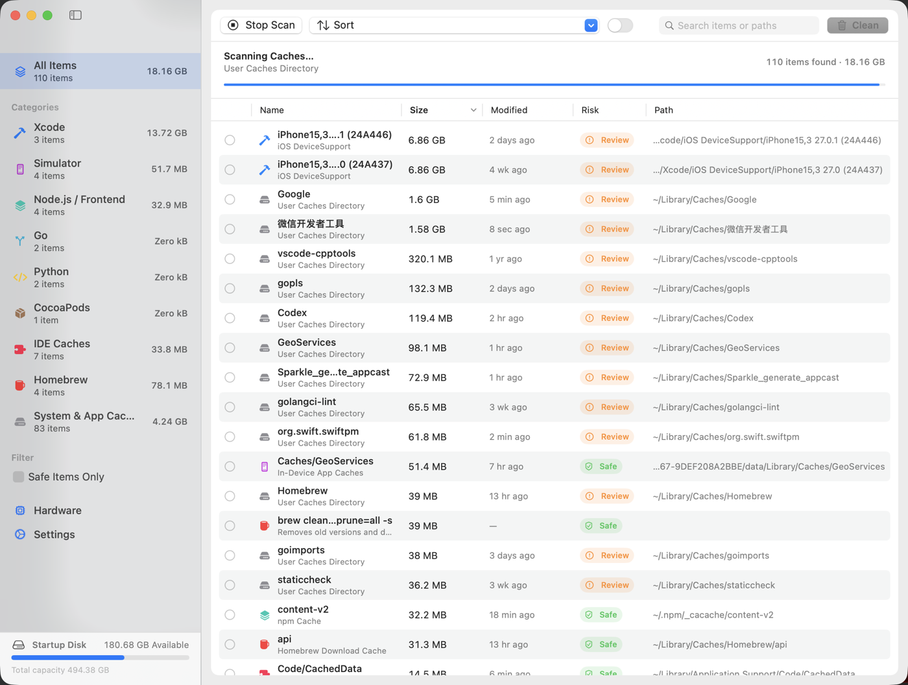

<div align="center">


# Mackit

**Un nettoyeur de caches pour développeurs macOS** — scannez tous les caches régénérables laissés par votre chaîne d'outils, sélectionnez les éléments un par un avec des étiquettes de risque claires, et récupérez votre espace disque.

[](https://www.apple.com/macos/)
[](https://www.swift.org/)
[](LICENSE)
[](https://github.com/virskor/mackit/releases)
[](https://github.com/virskor/mackit/releases)

[Français](README_FR.md) · [English](README.md) · [简体中文](README_ZH.md) · [繁體中文](README_ZH_HANT.md) · [한국어](README_KO.md) · [日本語](README_JA.md) · [Русский](README_RU.md) · [Español](README_ES.md)

🌐 [Site officiel](https://www.mingcui.cn) · ⬇️ [Télécharger](https://www.mingcui.cn/download/mackit)

</div>

---

## Pourquoi Mackit

Go, Node, Yarn, pnpm, Dart, Flutter, Rust, Python, CocoaPods, Gradle, Xcode, Android Studio… chacun de ces outils laisse sur votre machine des **caches régénérables** : téléchargements de paquets, intermédiaires de compilation, caches de modules, données de simulateurs, index d'outils. Aucun ne semble gros isolément ; ensemble, ils totalisent des dizaines de gigaoctets. Et dans le Finder, ils se cachent dans une douzaine de dossiers cachés où vous ne pouvez ni voir leur taille ni les supprimer en sécurité.

Ce que fait Mackit :

1. **Scanner** — énumère en parallèle plus de 60 règles pour trouver les caches, artéfacts de compilation et fichiers résiduels où qu'ils se trouvent, en diffusant les résultats au fil de l'eau pour que les tailles apparaissent pendant que l'analyse tourne encore ;
2. **Étiqueter** — chaque élément porte un niveau de risque (Sûr / À vérifier / Prudence) et son chemin complet, si bien que vous savez ce qui va se passer avant de supprimer ;
3. **Sélectionner** — rien n'est coché par défaut ; vous choisissez élément par élément, ou sélectionnez tous les éléments « sûrs » en une seule action ;
4. **Supprimer** — mettre dans la Corbeille (réversible) ou supprimer définitivement ; les éléments en ligne de commande appellent les commandes de nettoyage propres à chaque outil.

## Fonctionnalités

- **Analyse en un clic** : 77 règles de chemins + 13 règles de nettoyage en ligne de commande, diffusées dans la liste pendant que l'analyse tourne encore
- **Trois niveaux de risque** : `Sûr` (cache pur, recréé par l'outil) / `À vérifier` (nécessite un retéléchargement ou une recompilation) / `Prudence` (Corbeille, sauvegardes iOS, etc. — confirmation supplémentaire requise)
- **Désinstallation d'apps** : une page d'outils (section « Outils » de la barre latérale) listant les apps installées dans `/Applications` et `~/Applications` ainsi que leurs fichiers résiduels dans `~/Library` (support d'app, caches, conteneurs, préférences, éléments de session…), permettant de désinstaller une app avec ses fichiers résiduels ou de ne balayer que les résidus ; les apps en cours d'exécution sont refusées
- **Balayage des résidus d'apps** : l'analyse de nettoyage couvre la partie régénérable des fichiers résiduels d'une app (caches, stockages HTTP, données WebKit, journaux, rapports de plantage) dans la ligne « Résidus d'apps » du module général — par app, si bien que vous pouvez conserver le cache d'une app tout en balayant les autres
- **Analyse des artéfacts de compilation** : pointez un dossier (par ex. `~/Projects`) pour trouver `node_modules`, `build`, `Pods`, `.dart_tool`, `DerivedData`, `target`, `.venv` et d'autres dossiers reconstructibles
- **Nettoyage en ligne de commande** : `go clean -cache`, `npm cache clean`, `brew cleanup`, `dart pub cache clean`, etc.
- **Panneau de la barre des menus** : une icône résidente dans la barre des menus ouvre un panneau affichant l'espace récupérable, le CPU / la mémoire / la température, le classement de la mémoire par app avec « libérer la mémoire » en un clic, l'espace disque libre et un graphique CPU
- **Superposition de stats sur le bureau** : une barre optionnelle toujours au premier plan affichant CPU / mémoire / température de façon compacte, lisible sur n'importe quel fond d'écran, déplaçable avec mémorisation de la position, vivant uniquement dans le processus de la barre des menus
- **Analyse de l'espace disque** : une page d'outils (section « Outils » de la barre latérale, sous les entrées de nettoyage) répondant à « où est passé l'espace » — navigation par fil d'Ariane depuis le disque de démarrage, taille récursive de chaque dossier, et treemap de la répartition du dossier sélectionné
- **Infos matériel** : modèle, disques, batterie et autres informations statiques
- **UI native** : barre latérale + table + barre d'outils SwiftUI avec menus contextuels natifs, raccourcis clavier, recherche et en-têtes de colonnes cliquables pour trier
- **Localisée** : chinois simplifié / anglais / chinois traditionnel / coréen / japonais / russe / espagnol / français, suit la langue du système par défaut
- **Garde-fous de sécurité** : liste de chemins protégés intégrée ; les dossiers système et le trousseau sont toujours refusés

## Capture d'écran



> Les captures d'écran du panneau de la barre des menus, de la superposition sur le bureau et de la page matériel sont encore à venir.

## Installation

### Télécharger un binaire précompilé (recommandé)

⬇️ [Télécharger Mackit](https://www.mingcui.cn/en/download/mackit)

Récupérez le dernier DMG depuis [Releases](https://github.com/virskor/mackit/releases), ouvrez-le et faites glisser Mackit dans Applications.

- Binaire universel (arm64 + x86_64), compatible avec les Mac Apple silicon comme avec les Mac Intel
- Nécessite macOS 14 ou version ultérieure (les machines Intel doivent pouvoir exécuter macOS 14)
- Première installation via DMG ; les mises à jour suivantes via la mise à jour automatique Sparkle intégrée à l'app

### Compiler depuis les sources

Nécessite macOS 14+ et Xcode 16+ (Swift 6) :

```bash
git clone https://github.com/virskor/mackit.git
cd mackit

# Option 1 : compiler et lancer en une seule étape (debug, l'itération la plus rapide)
./run.sh

# Option 2 : compiler le Mackit.app de release, puis le lancer
Scripts/build-app.sh release
open Mackit.app
```

Vous pouvez aussi ouvrir `Package.swift` dans Xcode et exécuter le schéma `Mackit`. Les builds de développement ne compilent que pour l'architecture native ; le binaire universel distribuable (arm64 + x86_64) est couvert dans les [notes de version](docs/RELEASE.md).

Exécuter les tests :

```bash
swift test
```

## Utilisation

1. Au premier lancement, l'analyse est automatique ; **rien n'est coché par défaut** — c'est vous qui décidez quoi supprimer
2. Parcourez les catégories dans la barre latérale, ou recherchez des éléments / chemins depuis la barre d'outils
3. Ajoutez vos racines de code dans « Réglages › Dossiers de projets » pour analyser les artéfacts de compilation comme `node_modules`
4. Pour désinstaller une app : ouvrez l'outil « Désinstallation d'apps » dans la section Outils de la barre latérale, cochez l'app (ou dépliez la ligne pour cocher des fichiers résiduels individuels), puis confirmez
5. Après avoir coché des éléments, cliquez sur « Nettoyer X GB » dans la barre d'outils ; le panneau de confirmation liste les détails et les notes de risque
6. Gardez « Mettre dans la Corbeille » activé et ne videz la Corbeille qu'une fois que vous êtes sûr

Raccourcis clavier :

| Raccourci | Action |
| --- | --- |
| `⌘R` | Relancer l'analyse |
| `⌘⌫` | Nettoyer la sélection |
| `⌘⌥S` | Sélectionner tous les éléments sûrs |
| `⌘,` | Réglages |

## Couverture

| Catégorie | Contenu |
| --- | --- |
| Artéfacts de compilation | node_modules, build, Pods, .gradle, .dart_tool, DerivedData, dist, target, .venv, __pycache__, etc. |
| Xcode | DerivedData, Archives, DeviceSupport iOS/watchOS, DocumentationCache, caches de modules |
| Simulateurs | caches dyld, caches d'apps sur l'appareil, dossiers temporaires de l'appareil, journaux du simulateur |
| Java | caches Gradle, distributions du wrapper, journaux du daemon, JDK de Gradle, dépôt Maven |
| Android | caches du SDK Android, caches Android Studio, Kotlin/Native |
| Node / frontend | npm `_cacache`, Yarn, pnpm store, Bun, node-gyp, TypeScript, ESLint, Deno |
| Flutter / Dart | pub-cache (hosted / git / temp), Dart Analysis Server |
| Go | cache go-build, cache de téléchargement des modules |
| Rust | cache/src du registre cargo, dépendances git |
| Python | caches pip, uv, Poetry, pre-commit |
| Ruby | cache de specs RubyGems, gems installés par l'utilisateur, cache Bundler |
| PHP | cache Composer |
| .NET | paquets globaux NuGet, cache HTTP |
| Scala / JVM | cache Coursier, boot sbt, cache Ivy |
| Haskell | cache de paquets Cabal et dépôt de build, chaînes d'outils et instantanés Stack |
| Clojure | bibliothèques git tools.deps, installation Leiningen |
| Elixir / Erlang | cache du registre Hex, archives Mix, cache rebar3 |
| Lua | arbre LuaRocks |
| Julia | cache de précompilation, registres, paquets installés |
| OCaml | cache de téléchargement opam, index de paquets |
| Zig | cache global du compilateur |
| Nim | cache du compilateur, paquets Nimble |
| Crystal | cache du compilateur |
| Perl | sources CPAN, restes de compilation |
| CocoaPods | cache CocoaPods, cache Carthage, dépôts de specs |
| IDE | caches et journaux JetBrains, VS Code / Cursor |
| Homebrew | cache de téléchargement |
| Système et apps | `~/Library/Caches`, caches d'apps sandboxées, journaux, rapports de plantage, sauvegardes iOS |
| Corbeille | fichiers dans `~/.Trash` |

Les éléments de nettoyage en ligne de commande sont regroupés sous la catégorie de leur outil, affichés à côté des règles de chemins correspondantes.

### Désinstallation d'apps

La désinstallation d'apps est une page d'outils à part entière dans la section Outils de la barre latérale, elle ne fait pas partie de l'analyse de nettoyage : la page liste chaque app installée avec son icône réelle, sa version, sa taille et son nombre de fichiers résiduels ; une ligne par app avec une case à cocher à trois états — la cocher sélectionne d'un coup le bundle de l'app et tous ses fichiers résiduels, et déplier la ligne révèle chaque fichier résiduel avec sa propre case, si bien qu'un simple cache ou fichier de préférences peut être conservé ou supprimé individuellement. Un clic droit sur une ligne d'app donne accès aux deux raccourcis :

- **Désinstaller avec les fichiers résiduels…** : coche l'app elle-même plus tous ses fichiers résiduels et ouvre la confirmation
- **Nettoyer uniquement les fichiers résiduels…** : nettoie les résidus, garde l'app

La désinstallation réutilise le flux de nettoyage unifié : l'app et ses fichiers résiduels suivent tous deux le réglage « Réglages › Méthode de nettoyage » — mettre dans la Corbeille (réversible) ou supprimer définitivement. Les apps en cours d'exécution sont refusées, avec une note de résultat demandant de les quitter d'abord ; la feuille de confirmation les nomme à l'avance. Les fichiers résiduels sont étiquetés selon leur emplacement — les caches et les journaux sont « Sûr » ; le support d'app, les préférences, les conteneurs et autres emplacements pouvant contenir des données utilisateur sont « À vérifier ».

Si seule l'app elle-même est cochée, la feuille de confirmation indique combien de fichiers associés restent décochés (nombre et taille par app) et propose un raccourci « Tout cocher », afin de ne pas se retrouver avec une coquille de dossier vide et les caches encore sur le disque.

Ce que l'analyse de nettoyage garde du monde des apps, c'est la moitié régénérable : la ligne « Résidus d'apps » du module général balaie caches, stockages HTTP, données WebKit, journaux et rapports de plantage par app — des résidus qu'une app reconstruit à la demande — si bien que vous pouvez libérer cet espace sans rien désinstaller, et aucune donnée d'app n'est jamais atteignable depuis l'analyse de nettoyage.

Limitations connues : les conteneurs de groupe (Group Containers, qui nécessitent la lecture des entitlements par app), les désinstalleurs livrés avec les apps et les LaunchAgents/Daemons au niveau système (qui nécessitent les droits administrateur) ne sont pas couverts ; les apps installées dans des emplacements personnalisés, découvertes via une analyse Spotlight complète, sont également hors de portée.

## Autorisations

Mackit a besoin de lire `~/Library`, `~/.pub-cache`, `~/.gradle`, `/Applications` et des emplacements similaires, ce qui explique que le **App Sandbox ne soit pas activé**. Certains chemins sous `~/Library` nécessitent l'accès complet au disque, que l'utilisateur peut accorder manuellement dans « Réglages système › Confidentialité et sécurité › Accès complet au disque ». Ouvrir un chemin dans le Terminal demande l'autorisation Apple Events permettant de contrôler le Terminal (`NSAppleEventsUsageDescription`). « Libérer de la mémoire » dans le panneau de la barre des menus demande une autorisation administrateur et exécute `purge` (ce qui vide le cache de fichiers ; la mémoire détenue par les apps elles-mêmes n'est pas affectée). L'outil d'analyse disque n'entre volontairement pas dans `~/Documents`, `~/Desktop` ou `~/Downloads` pendant une analyse — les énumérer fait apparaître la boîte de dialogue d'accès du système — si bien que ces dossiers sont listés comme « non analysés » et peuvent être analysés à la demande (un clic, ou accordez l'accès complet au disque pour une analyse complète). Le CPU, la mémoire et la mémoire par app proviennent d'interfaces système publiques (`host_statistics64`, `proc_pid_rusage`) ; macOS n'expose aucune API de température publique, si bien que la température affichée est l'état thermique du système. Réglages → Général comporte une section Autorisations qui rend compte en direct de chacune de ces autorisations — accordée ou non, ce qu'elle débloque, et un bouton qui ouvre la ligne de réglages exacte (ou, pour un consentement d'automatisation que l'app n'a jamais demandé, le demande au système — macOS ne liste une app dans le panneau Automatisation qu'une fois que l'app a demandé) — si bien qu'une fonctionnalité qui semble cassée peut être rattachée en un clic à l'autorisation qui se cache derrière elle.

## Développement

### Architecture : app principale + agent de la barre des menus

Mackit est deux processus issus d'un même binaire, livrés dans deux bundles qui changent de rôle selon l'identifiant de bundle :

| | Mackit.app (`cn.mingcui.mackit`) | MackitAgent.app (`cn.mingcui.mackit.agent`) |
| --- | --- | --- |
| Forme | app classique, avec une icône dans le Dock | LSUIElement, barre des menus uniquement |
| Rôle | fenêtre principale, analyse, nettoyage, réglages, mises à jour Sparkle | icône et panneau de la barre des menus, superposition de stats sur le bureau, surveillance du système |
| Cycle de vie | se termine à la fermeture de la fenêtre | résident ; un élément de session le lance à la connexion |

**Fermer la fenêtre principale = le processus principal se termine = l'icône du Dock disparaît, tandis que la surveillance de la barre des menus continue de tourner toutes les minutes** — c'est ainsi qu'est implémenté « fenêtre fermée mais la barre des menus survit », sans aucune bascule de politique d'activation à l'exécution (basculer entre regular et accessory à l'exécution fait reconstruire la barre des menus par macOS et ajouter/supprimer des tuiles du Dock à chaque fois, ce qui est exactement pourquoi la barre des menus scintille et la ligne du Dock se décale).

Comment les deux processus coopèrent (`Sources/Mackit/IPC/`) :

- **Commandes** : l'agent envoie des notifications distribuées (ouvrir la fenêtre / réglages / matériel / nettoyer / quitter / toast) ; si l'app principale ne tourne pas, les commandes sont d'abord persistées sur disque et rejouées après son lancement (compensation de démarrage à froid)
- **État** : l'app principale diffuse l'état d'analyse / de nettoyage à l'agent, si bien que l'en-tête du panneau peut afficher la « taille récupérable » et le nombre d'éléments cochés ; les données de surveillance sont à leur tour interrogées par l'agent seul — elles doivent continuer de tourner après la sortie de l'app principale
- **Réglages** : fichier partagé `~/Library/Application Support/Mackit/shared-settings.plist`, écrit par l'app principale et lu par l'agent, avec un rafraîchissement par diffusion à chaque changement. Les App Groups ne sont pas utilisés : sous signature ad-hoc, le conteneur de groupe ne peut pas être résolu (cfpregs rapporte `Container: (null)` et toute la source se retrouve détachée), ce qui ne se récupère qu'avec une signature Developer ID payante — l'itération de développement ne doit pas dépendre d'un certificat
- **Élément de session** : enregistre l'agent (`SMAppService.loginItem`), si bien qu'à la connexion seule l'icône de la barre des menus apparaît ; l'app principale relance l'agent s'il manque, et veille sur lui toutes les 30 secondes pendant qu'elle tourne (la barre des menus s'auto-répare après un plantage de l'agent)
- **Instance unique** : un seul agent par identifiant de bundle est autorisé — enregistrer l'élément de session fait démarrer un agent par launchd au même instant, si bien que si l'app principale en avait déjà démarré un, deux icônes de barre des menus apparaîtraient ; l'instance tardive cède la place quand elle voit sa prédécesseure
- **Résidence** : l'Info.plist de l'agent désactive `NSSupportsAutomaticTermination` / `NSSupportsSuddenTermination`, et il appelle `disableAutomaticTermation` au lancement

### Compatibilité macOS 14

Le plancher est la cible de compilation macOS 14 : aucune source n'utilise d'API au-delà de 14.0 (`swift build` rapporte zéro avertissement de disponibilité contre la cible 14.0). Le seul symbole nécessitant le runtime macOS 15.0+, `withTaskGroup(of:returning:isolation:body:)`, est compilé avec liaison faible plus une vérification de version à l'exécution, avec repli sur une implémentation locale en 14.x, si bien qu'aucun symbole manquant n'est jamais résolu. La page matériel et la surveillance de la barre des menus utilisent les mêmes interfaces publiques sur Apple silicon et Intel (`HardwareSampler` se dégrade en douceur quand Intel n'a pas de niveaux de perf).

### Localisation

Toutes les chaînes visibles par l'utilisateur vivent dans `Sources/Mackit/Resources/Localizable.xcstrings` (String Catalog), avec le chinois simplifié comme langue source, plus les traductions anglaise, chinois traditionnel, coréenne, japonaise, russe, espagnole et française. Aucun littéral visible par l'utilisateur n'apparaît dans le code ; tout passe par `Utilities/L10n.swift` :

```swift
Text(verbatim: L10n.tr("toolbar.rescan"))                 // chaîne statique
Text(verbatim: L10n.fmt("toast.trashed", item.title))     // avec espaces réservés : %@ / %lld
Text(verbatim: L10n.items(count))                         // « N éléments », pluriel géré
```

Pour ajouter une langue : traduisez-la dans le catalogue (ouvrez-le dans Xcode, cliquez sur `+` en bas à gauche), puis enregistrez-la — un cas `AppLanguage` avec son endonyme et la correspondance avec les préférences système dans `Utilities/AppLanguage.swift`, la langue dans les deux tableaux `CFBundleLocalizations` de `Scripts/build-app.sh`, et, une fois qu'elle est livrée dans l'UI, son sous-tag principal dans `LanguageFileScanner.isWhitelisted` pour que la règle de pack de langue la conserve. Les nouvelles chaînes sont ajoutées comme clés dans le catalogue ; `LocalizationTests` dans la suite de tests vérifie la complétude des clés et la cohérence des espaces réservés par rapport aux sites d'appel.

La sélection de la langue d'interface se trouve dans `Utilities/AppLanguage.swift` : « Suivre le système » plus huit langues, stockées dans UserDefaults sous `appLanguage` et répercutées dans les `AppleLanguages` du domaine de l'app — la recherche de chaînes de CFBundle lit cette clé, si bien qu'elle prend effet après un redémarrage (l'interface de mise à jour Sparkle et les panneaux de fichiers système suivent aussi). Pourquoi un redémarrage plutôt qu'une bascule dans le processus : les titres et descriptions des résultats d'analyse sont figés dans la langue courante au moment de leur création, si bien qu'un rafraîchissement en cours de processus ne produirait qu'une liste aux langues mélangées (voir les commentaires du code source pour les détails).

### Journalisation

Les événements de cycle de vie (démarrage d'une analyse / d'un nettoyage, achèvement, annulation, échec) et les changements de forme de fenêtre passent tous par un `os.Logger` unifié (subsystem = identifiant de bundle), enregistré également dans les builds release. Chaque processus journalise sous son propre subsystem : `cn.mingcui.mackit` pour l'app principale, `cn.mingcui.mackit.agent` pour l'agent de la barre des menus. À voir en direct :

```bash
log stream --predicate 'subsystem == "cn.mingcui.mackit"' --level info
# journaux de l'agent de la barre des menus (lancement, relance, surveillance)
log stream --predicate 'subsystem == "cn.mingcui.mackit.agent"' --level info
# détails d'énumération par répertoire (quels répertoires illisibles ont été ignorés) : ajoutez --level debug
```

Filtrez par subsystem dans l'app Console. Seuls les nombres, tailles, durées et identifiants de règles sont journalisés — jamais le contenu des fichiers.

### Structure du projet

```
Sources/Mackit/
├── MackitApp.swift               # répartition d'entrée (@main change le rôle selon l'identifiant de bundle) + fenêtre/menu principal + AppDelegate partagé
├── AgentApp.swift                # entrée de l'agent de la barre des menus (MenuBarExtra + libellés)
├── Models/                       # modèles de données : éléments, catégories, niveaux de risque, règles d'analyse, comparateurs
├── Engine/
│   ├── RulesCatalog.swift        # 77 règles d'analyse et 13 commandes de nettoyage CLI
│   ├── AppScanner.swift          # découverte des apps installées et détection des fichiers résiduels (alimente l'outil de désinstallation et la ligne de résidus d'apps)
│   ├── FileSystem.swift          # calcul de taille, globbing, recherche d'outils, capacité du volume
│   ├── Scanner.swift             # analyse concurrente + parcours des répertoires de projets
│   ├── DiskAnalyzer.swift        # analyse de l'espace disque : listage par répertoire + mesure récursive
│   ├── TreemapLayout.swift       # disposition de treemap squarified (fonction pure)
│   └── Cleaner.swift             # suppression / corbeille / exécution de commandes
├── Monitor/                      # échantillonnage CPU / mémoire / température, infos matérielles, libération de mémoire
├── IPC/                          # canaux inter-processus de commandes / état / réglages (notifications distribuées + plist partagé)
├── Updater/
│   └── UpdateController.swift    # mise à jour automatique Sparkle
├── ViewModels/
│   ├── AppViewModel.swift        # machine à états : analyse, sélection, nettoyage, réglages (une par processus)
│   ├── DiskAnalysisModel.swift   # page d'analyse disque : navigation, mesure en flux, cache
│   ├── HomebrewModel.swift       # page du gestionnaire Homebrew : instantané, sections, actions, recherche
│   └── AppUninstallModel.swift   # page de désinstallation d'apps : liste des apps, sélection, flux de désinstallation
├── Views/                        # SwiftUI : fenêtre principale, panneau de la barre des menus, superposition, réglages, matériel, analyse disque
│   └── Components/               # composants réutilisables (badges, anneau de progression, lignes d'avis, disposition en flux…)
└── Utilities/
    ├── AppLanguage.swift         # sélection de la langue d'interface (système + huit langues, écrit AppleLanguages)
    ├── MackitLog.swift           # enveloppe unifiée d'os.Logger
    ├── Formatters.swift          # formatage des octets et du temps
    ├── LaunchAtLogin.swift       # enregistrement de l'élément de connexion (pointe vers le MackitAgent.app intégré)
    └── L10n.swift                # recherche de localisation (catalogue de chaînes)
    Resources/
    ├── Localizable.xcstrings     # huit langues (zh-Hans / en / zh-Hant / ko / ja / ru / es / fr)
    └── sparkle-blue.png          # icône de marque (partagée par l'affichage en app et l'icône de l'app)
Scripts/                          # scripts de build / empaquetage / génération d'icônes
Tests/MackitTests/                # 52 fichiers de test
```

### Tests

`swift test`. 52 fichiers de tests couvrent le moteur d'analyse, le moteur de nettoyage, le catalogue de règles, la désinstallation d'apps, l'analyse des résidus d'apps, le stockage partagé, les comparateurs de tri, l'intégrité des clés de localisation, le contrôleur de mise à jour et plus encore.

### Publication

La signature, la notarisation, l'empaquetage DMG et le pipeline de mise à jour Sparkle sont réservés aux mainteneurs ; voir [docs/RELEASE.md](docs/RELEASE.md).

## Contribution

Les issues et les PR sont les bienvenues. Compilation, tests et conventions de code : [CONTRIBUTING.md](CONTRIBUTING.md). En participant, vous acceptez de respecter le [code de conduite](CODE_OF_CONDUCT.md).

## Sécurité

Les clés privées, certificats et identifiants **n'entrent jamais dans le dépôt** : `secrets/` et tous les fichiers `*.p8` / `*.pem` / `*.key` sont bloqués par `.gitignore`, et le hook pre-commit (installé via `Scripts/install-git-hooks.sh`) analyse la zone de staging pour intercepter les clés privées. Merci de ne pas ouvrir d'issues publiques pour les problèmes de sécurité — signalez-les en privé via GitHub Security Advisory.

## Licence

[MIT](LICENSE) © 2026 virskor

## Remerciements

- [Sparkle 2](https://sparkle-project.org/) — mise à jour automatique intégrée à l'app
