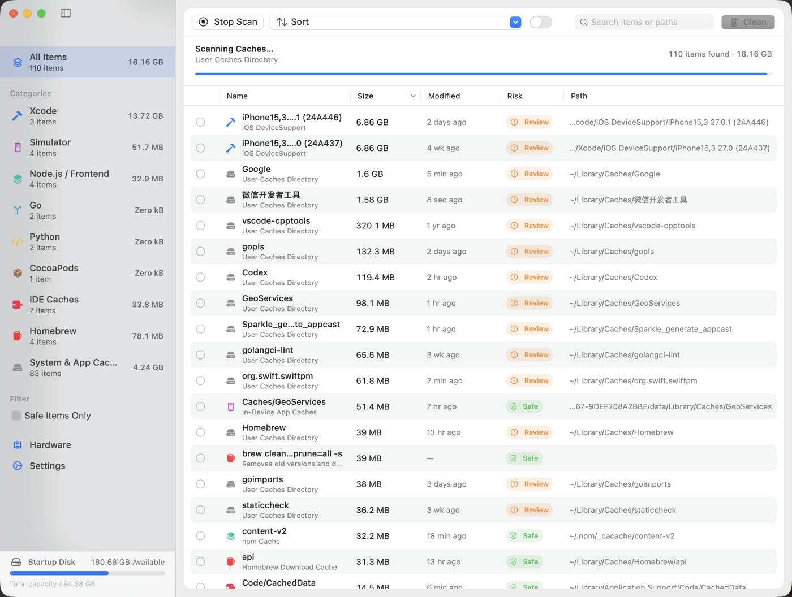

<div align="center">


# Mackit

**macOS 개발자 캐시 정리 도구** — 툴체인이 남긴 모든 재생성 가능한 캐시를 스캔하고, 명확한 위험도 라벨과 함께 항목을 하나씩 선택해 디스크 공간을 되찾으세요.

[](https://www.apple.com/macos/)
[](https://www.swift.org/)
[](LICENSE)
[](https://github.com/virskor/mackit/releases)
[](https://github.com/virskor/mackit/releases)

[한국어](README_KO.md) · [English](README.md) · [简体中文](README_ZH.md) · [繁體中文](README_ZH_HANT.md) · [日本語](README_JA.md)

🌐 [공식 웹사이트](https://www.mingcui.cn)

</div>

---

## 왜 Mackit인가

Go, Node, Yarn, pnpm, Dart, Flutter, Rust, Python, CocoaPods, Gradle, Xcode, Android Studio…… 이 모든 도구는 로컬에 **재생성 가능한 캐시**를 남깁니다: 패키지 다운로드, 빌드 중간 산출물, 모듈 캐시, 시뮬레이터 데이터, 도구 인덱스. 하나만 보면 크지 않지만 모이면 수십 GB에 이르고, Finder에서는 십여 개의 숨은 디렉토리에 흩어져 크기를 볼 수도 없고 안전하게 삭제할 수도 없습니다.

Mackit이 하는 일:

1. **스캔** — 60개 이상의 규칙을 동시에 열거해 캐시, 빌드 산출물, 잔여 파일이 어디에 있든 찾아내고, 결과를 스트리밍으로 전달해 스캔 중에도 크기를 확인할 수 있습니다;
2. **표시** — 모든 항목에 위험도(안전 / 검토 / 주의)와 전체 경로가 표시되어, 삭제하기 전에 어떤 일이 일어날지 알 수 있습니다;
3. **선택** — 기본적으로 아무것도 선택되지 않으며, 직접 항목별로 고르거나 "안전" 항목을 한 번에 전체 선택할 수 있습니다;
4. **삭제** — 휴지통으로 이동(복원 가능)하거나 영구 삭제합니다. 명령줄 항목은 도구 자체의 정리 명령을 실행합니다.

## 기능

- **클릭 한 번으로 스캔**: 77개의 경로 규칙 + 13개의 명령줄 정리 규칙을, 스캔이 진행되는 동안 목록에 스트리밍으로 채웁니다
- **세 가지 위험도**: `안전`(도구가 다시 만드는 순수 캐시) / `검토`(다시 다운로드하거나 다시 빌드해야 함) / `주의`(휴지통, iOS 백업 등 — 추가 확인 필요)
- **앱 제거**: 사이드바 "도구" 영역의 도구 페이지로, `/Applications`와 `~/Applications`에 설치된 앱과 `~/Library`의 잔여 파일(앱 지원, 캐시, 컨테이너, 환경설정, 로그인 항목…)을 함께 표시합니다. 잔여 파일과 함께 앱을 제거하거나 잔여 파일만 정리할 수 있으며, 실행 중인 앱은 거부됩니다
- **앱 정크 정리**: 정리 스캔이 범용 모듈의 "앱 정크" 행에서 앱 잔여 파일의 재생성 가능한 부분(캐시, HTTP 저장소, 웹킷 데이터, 로그, 크래시 보고서)을 다룹니다. 앱별로 구분되어 한 앱의 캐시는 남겨두고 나머지만 정리할 수 있습니다
- **빌드 산출물 스캔**: 디렉토리(예: `~/Projects`)를 지정하면 `node_modules`, `build`, `Pods`, `.dart_tool`, `DerivedData`, `target`, `.venv` 등 다시 빌드할 수 있는 폴더를 찾습니다
- **명령줄 정리**: `go clean -cache`, `npm cache clean`, `brew cleanup`, `dart pub cache clean` 등
- **메뉴 막대 패널**: 상주하는 메뉴 막대 아이콘을 클릭하면 확보 가능한 공간, CPU / 메모리 / 온도, 원터치 "메모리 확보"를 제공하는 앱별 메모리 순위, 사용 가능한 디스크 공간과 CPU 그래프가 표시됩니다
- **데스크탑 상태 표시줄**: 선택 사항인 항상 위에 표시되는 막대로, CPU / 메모리 / 온도를 간결하게 보여줍니다. 어떤 배경화면에서도 읽을 수 있고, 드래그하면 위치가 기억되며, 메뉴 막대 에이전트 프로세스에만 존재합니다
- **디스크 공간 분석**: 사이드바 "도구" 영역(정리 항목 아래)의 도구 페이지로, "공간이 어디로 갔는지"에 답합니다 — 시동 디스크부터 브레드크럼으로 단계적으로 내려가고, 모든 폴더의 재귀적 크기와 선택한 폴더의 구성을 treemap으로 보여줍니다
- **하드웨어 정보**: 기종, 디스크, 배터리 등 정적 정보
- **네이티브 UI**: 네이티브 컨텍스트 메뉴, 키보드 단축키, 검색, 클릭으로 정렬하는 열 헤더를 갖춘 SwiftUI 사이드바 + 테이블 + 툴바
- **현지화**: 简体中文 / English / 繁體中文 / 한국어 / 日本語, 기본적으로 시스템 언어를 따름
- **안전 가드레일**: 내장된 보호 경로 목록이 있으며, 시스템 디렉토리와 키체인은 항상 거부됩니다

## 스크린샷



> 메뉴 막대 패널, 데스크탑 오버레이, 하드웨어 페이지의 스크린샷은 추후 추가될 예정입니다.

## 설치

### 사전 빌드된 바이너리 다운로드(권장)

[Releases](https://github.com/virskor/mackit/releases)에서 최신 DMG 파일을 내려받아 열고, Mackit을 "응용 프로그램"에 드래그하세요.

- Apple silicon과 Intel Mac을 모두 지원하는 유니버설 바이너리(arm64 + x86_64)
- macOS 14 이상 필요(Intel 기기는 macOS 14를 실행할 수 있어야 함)
- 첫 설치는 DMG로, 이후 업데이트는 앱 내 Sparkle 자동 업데이트로 진행합니다

### 소스에서 빌드

macOS 14+와 Xcode 16+(Swift 6)가 필요합니다:

```bash
git clone https://github.com/virskor/mackit.git
cd mackit

# 방법 1: 한 번에 빌드하고 실행(debug, 반복 작업에 가장 빠름)
./run.sh

# 방법 2: release용 Mackit.app을 빌드한 뒤 실행
Scripts/build-app.sh release
open Mackit.app
```

Xcode에서 `Package.swift`를 열고 `Mackit` scheme을 실행할 수도 있습니다. 개발 빌드는 현재 아키텍처로만 컴파일되며, 배포용 유니버설 바이너리(arm64 + x86_64)는 [릴리스 노트](docs/RELEASE.md)를 참조하세요.

테스트 실행:

```bash
swift test
```

## 사용법

1. 첫 실행 시 자동으로 스캔하며, **기본적으로 아무것도 선택되지 않습니다** — 삭제할 항목은 직접 결정하세요
2. 사이드바에서 카테고리별로 살피거나, 툴바에서 항목 / 경로를 검색하세요
3. "설정 › 프로젝트 디렉토리"에 코드 루트를 추가하면 `node_modules` 같은 빌드 산출물을 스캔합니다
4. 앱을 제거하려면: 사이드바 "도구" 영역의 "앱 제거" 도구를 열고, 앱을 선택한 뒤(또는 행을 펼쳐 잔여 파일을 개별적으로 선택) 확인하세요
5. 항목을 선택한 뒤 툴바의 "X GB 정리"를 클릭하면, 확인 패널에 세부 내용과 위험도 안내가 표시됩니다
6. "휴지통으로 이동"을 켜둔 상태로 유지하고, 확실해진 뒤에 휴지통을 비우세요

키보드 단축키:

| 단축키 | 동작 |
| --- | --- |
| `⌘R` | 다시 스캔 |
| `⌘⌫` | 선택한 항목 정리 |
| `⌘⌥S` | 안전 항목 전체 선택 |
| `⌘,` | 설정 |

## 스캔 범위

| 카테고리 | 내용 |
| --- | --- |
| 빌드 산출물 | node_modules, build, Pods, .gradle, .dart_tool, DerivedData, dist, target, .venv, __pycache__ 등 |
| Xcode | DerivedData, Archives, iOS/watchOS DeviceSupport, DocumentationCache, 모듈 캐시 |
| 시뮬레이터 | dyld 캐시, 기기 내 앱 캐시, 기기 임시 디렉토리, 시뮬레이터 로그 |
| Android / Gradle | Gradle 캐시, wrapper 배포판, 데몬 로그, Android Studio 캐시, Kotlin/Native, Maven 저장소 |
| Node / 프론트엔드 | npm `_cacache`, Yarn, pnpm store, Bun, node-gyp, TypeScript, ESLint, Deno |
| Flutter / Dart | pub-cache(hosted / git / temp), Dart Analysis Server |
| Go | go-build 캐시, 모듈 다운로드 캐시 |
| Rust | cargo registry 캐시/src, git 종속 항목 |
| Python | pip, uv, Poetry, pre-commit 캐시 |
| Ruby | RubyGems 스펙 캐시, 사용자 설치 Gem, Bundler 캐시 |
| PHP | Composer 캐시 |
| .NET | NuGet 전역 패키지, HTTP 캐시 |
| Scala / JVM | Coursier 캐시, sbt 부트 디렉토리, Ivy 캐시 |
| Haskell | Cabal 패키지 캐시 및 빌드 저장소, Stack 툴체인 및 스냅샷 |
| Clojure | tools.deps git 라이브러리, Leiningen 본체 |
| Elixir / Erlang | Hex 레지스트리 캐시, Mix 아카이브, rebar3 캐시 |
| Lua | LuaRocks 트리 |
| Julia | 사전 컴파일 캐시, 레지스트리, 설치된 패키지 |
| OCaml | opam 다운로드 캐시, 패키지 인덱스 |
| Zig | 컴파일러 전역 캐시 |
| Nim | 컴파일러 캐시, Nimble 패키지 |
| Crystal | 컴파일러 캐시 |
| Perl | CPAN 다운로드 소스, 빌드 잔여 파일 |
| CocoaPods | CocoaPods 캐시, Carthage 캐시, spec 저장소 |
| IDE | JetBrains, VS Code / Cursor 캐시 및 로그 |
| Homebrew | 다운로드 캐시 |
| 시스템 및 앱 | `~/Library/Caches`, 샌드박스 앱 캐시, 로그, 크래시 보고서, iOS 백업 |
| 휴지통 | `~/.Trash`의 파일 |

명령줄 정리 항목은 해당 도구의 카테고리 아래에 묶여, 관련 경로 규칙과 나란히 표시됩니다.

### 앱 제거

앱 제거는 사이드바 "도구" 영역에 있는 독립적인 도구 페이지이며, 정리 스캔의 일부가 아닙니다. 이 페이지는 설치된 모든 앱을 실제 아이콘, 버전, 크기, 잔여 파일 수와 함께 표시합니다. 앱마다 한 행에 3상태 체크박스가 하나씩 있습니다 — 체크하면 앱 번들과 모든 잔여 파일이 한 번에 선택되고, 행을 펼치면 각 잔여 파일의 개별 체크박스가 나타나 단일 캐시나 환경설정 파일만 골라 남기거나 삭제할 수 있습니다. 앱 행의 컨텍스트 메뉴에 두 가지 단축 작업이 있습니다:

- **잔여 파일과 함께 제거…**: 앱 자체와 모든 잔여 파일을 선택하고 확인 창을 엽니다
- **잔여 파일만 정리…**: 잔여 파일만 정리하고 앱은 유지합니다

제거도 통합 정리 흐름을 재사용합니다. 앱과 잔여 파일 모두 "설정 › 정리 방식" 설정을 따르며 — 휴지통으로 이동(복원 가능)하거나 영구 삭제합니다. 실행 중인 앱은 거부되며, 결과에 먼저 종료하라는 안내가 표시됩니다. 확인 시트에는 해당 앱의 이름이 미리 나열됩니다. 잔여 파일은 위치별로 라벨이 붙습니다 — 캐시와 로그는 "안전", 사용자 데이터가 있을 수 있는 앱 지원, 환경설정, 컨테이너 등은 "검토"입니다.

앱 자체만 체크한 경우, 확인 시트에 아직 선택되지 않은 관련 파일이 얼마나 남았는지(앱별 수량과 크기)가 표시되고 "전체 선택" 단축 작업이 제공됩니다. 그래서 빈 껍데기 디렉토리만 남고 캐시는 디스크에 그대로 있는 상황을 방지할 수 있습니다.

정리 스캔이 앱 세계에서 다루는 것은 재생성 가능한 절반뿐입니다. 범용 모듈의 "앱 정크" 행이 앱별로 캐시, HTTP 저장소, 웹킷 데이터, 로그, 크래시 보고서를 정리합니다 — 앱이 필요할 때 다시 만드는 정크이므로 — 아무것도 제거하지 않고도 이 공간을 확보할 수 있으며, 정리 스캔으로는 앱 데이터에 결코 닿지 않습니다.

알려진 제한: Group Containers(앱별 entitlement 읽기 필요), 앱에 포함된 제거 프로그램과 시스템 수준 LaunchAgents/Daemons(관리자 권한 필요)는 다루지 않으며, 전체 Spotlight 스캔으로 발견한 사용자 지정 위치에 설치된 앱도 범위에 없습니다.

## 권한

Mackit은 `~/Library`, `~/.pub-cache`, `~/.gradle`, `/Applications` 등과 유사한 위치를 읽어야 하므로 **App Sandbox가 활성화되지 않았습니다**. `~/Library` 아래 일부 경로는 전체 디스크 접근 권한이 필요하며, "시스템 설정 › 개인 정보 보호 및 보안 › 전체 디스크 접근 권한"에서 사용자가 직접 허용할 수 있습니다. 터미널에서 경로를 열면 터미널을 제어하기 위한 Apple Events 권한이 요청됩니다(`NSAppleEventsUsageDescription`). 메뉴 막대 패널의 "메모리 확보"는 관리자 인증을 요청하고 `purge`를 실행합니다(파일 캐시를 버리며, 앱 자체가 점유한 메모리는 영향을 받지 않습니다). 디스크 공간 분석 도구는 스캔 중 `~/Documents`, `~/Desktop`, `~/Downloads`에 의도적으로 들어가지 않습니다 — 이들을 열거하면 시스템 접근 대화상자가 뜨기 때문입니다 — 그래서 해당 폴더는 "스캔하지 않음"으로 표시되며, 필요에 따라 스캔할 수 있습니다(클릭 한 번, 또는 전체 디스크 접근 권한을 허용하면 완전히 스캔). CPU, 메모리, 앱별 메모리는 공개 시스템 인터페이스(`host_statistics64`, `proc_pid_rusage`)에서 가져옵니다. macOS에는 공개 온도 API가 없으므로 표시되는 온도는 시스템 열 상태입니다. 설정 → 일반의 "권한 관리" 항목은 이 각각을 실시간으로 보고합니다 — 허용 여부, 무엇을 열어주는지, 그리고 해당 설정 행으로 바로 이동하는 버튼(또는 앱이 한 번도 요청한 적 없는 자동화 동의의 경우 시스템에 먼저 요청합니다 — macOS는 앱이 요청한 뒤에야 자동화 목록에 앱을 표시합니다) — 덕분에 고장난 것처럼 보이는 기능도 한 번의 클릭으로 관련 권한을 찾아낼 수 있습니다.

## 개발

### 아키텍처: 메인 앱 + 메뉴 막대 에이전트

Mackit은 하나의 바이너리에 담긴 두 프로세스이며, bundle ID로 역할을 전환하는 두 개의 번들로 제공됩니다:

| | Mackit.app (`cn.mingcui.mackit`) | MackitAgent.app (`cn.mingcui.mackit.agent`) |
| --- | --- | --- |
| 형태 | 일반 앱, Dock 아이콘 보유 | LSUIElement, 메뉴 막대 전용 |
| 역할 | 메인 창, 스캔, 정리, 설정, Sparkle 업데이트 | 메뉴 막대 아이콘과 패널, 데스크탑 상태 표시줄, 시스템 모니터링 |
| 수명 주기 | 창을 닫으면 종료 | 상주, 로그인 시 로그인 항목이 실행 |

**메인 창을 닫으면 = 메인 프로세스가 종료되고 = Dock 아이콘이 사라지지만, 메뉴 막대 모니터링은 1분마다 계속 동작합니다** — 이것이 "창은 닫혔지만 메뉴 막대는 살아 있다"를 구현하는 방식이며, 실행 시 activation policy 전환은 전혀 하지 않습니다(실행 중 regular와 accessory 사이를 전환하면 macOS가 메뉴 막대를 다시 만들고 Dock 타일을 반복해서 추가/제거하게 하며, 이것이 바로 메뉴 막대가 깜빡이고 Dock 줄이 밀리는 원인입니다).

두 프로세스의 협력 방식(`Sources/Mackit/IPC/`):

- **명령**: 에이전트가 분산 알림을 보냅니다(창 열기 / 설정 / 하드웨어 / 정리 / 종료 / 토스트). 메인 앱이 실행 중이 아니면 명령을 먼저 디스크에 저장했다가 실행 후 재생합니다(콜드 스타트 보정)
- **상태**: 메인 앱이 스캔 / 정리 상태를 에이전트에 브로드캐스트하여, 패널 헤더에 "확보 가능한 크기"와 선택된 수를 표시할 수 있습니다. 모니터링 데이터는 반대로 에이전트만 폴링합니다. 메인 앱이 종료된 뒤에도 계속 동작해야 하기 때문입니다
- **설정**: 공유 파일 `~/Library/Application Support/Mackit/shared-settings.plist`를 메인 앱이 쓰고 에이전트가 읽으며, 변경 시 브로드캐스트로 갱신합니다. App Groups는 사용하지 않습니다. ad-hoc 서명에서는 Group Container를 해석할 수 없고(cfpregs가 `Container: (null)`을 보고하면 소스 전체가 detach됩니다), 유료 Developer ID 서명으로만 복구됩니다 — 개발 반복이 인증서에 의존해서는 안 됩니다
- **로그인 항목**: 에이전트를 등록(`SMAppService.loginItem`)하여 로그인 시 메뉴 막대 아이콘만 나타나게 합니다. 에이전트가 없어지면 메인 앱이 다시 실행하고, 실행 중에는 30초마다 돌봅니다(에이전트가 크래시하면 메뉴 막대가 스스로 복구됩니다)
- **단일 인스턴스**: bundle ID당 에이전트는 하나만 허용됩니다 — 로그인 항목을 등록하면 launchd가 같은 순간 하나를 끌어올리므로, 메인 앱이 이미 하나를 실행했다면 메뉴 막대 아이콘이 두 개 나타날 것입니다. 나중에 실행된 인스턴스는 앞선 인스턴스를 보면 양보합니다
- **상주**: 에이전트의 Info.plist가 `NSSupportsAutomaticTermination` / `NSSupportsSuddenTermination`을 끄며, 실행 시 `disableAutomaticTermation`을 호출합니다

### macOS 14 호환성

하한은 컴파일 대상 macOS 14입니다. 어떤 소스도 14.0을 초과하는 API를 사용하지 않습니다(14.0 대상 `swift build`는 가용성 경고가 0건입니다). macOS 15.0+ 런타임이 필요한 유일한 심볼 `withTaskGroup(of:returning:isolation:body:)`은 약한 링크(weak linking)와 런타임 버전 확인으로 컴파일되어, 14.x에서는 로컬 구현으로 대체되므로 심볼 해석 실패는 발생하지 않습니다. 하드웨어 페이지와 메뉴 막대 모니터링은 Apple silicon과 Intel에서 동일한 공개 인터페이스를 사용합니다(Intel에 perf level이 없을 때 `HardwareSampler`는 사용 가능한 정보만으로 동작합니다).

### 현지화

모든 사용자 대면 문자열은 `Sources/Mackit/Resources/Localizable.xcstrings`(String Catalog)에 있으며, 소스 언어는 简体中文이며 English, 繁體中文, 한국어, 日本語 번역이 함께 제공됩니다. 코드에는 사용자 대면 리터럴이 없으며, 모든 문자열은 `Utilities/L10n.swift`를 통합니다:

```swift
Text(verbatim: L10n.tr("toolbar.rescan"))                 // 정적 문자열
Text(verbatim: L10n.fmt("toast.trashed", item.title))     // 플레이스홀더 포함: %@ / %lld
Text(verbatim: L10n.items(count))                         // "N개 항목", 복수 처리됨
```

언어를 추가하려면: catalog에서 번역한 뒤(Xcode에서 열고 왼쪽 하단의 `+` 클릭) 등록을 완료합니다 — `Utilities/AppLanguage.swift`에 해당 언어의 자국어 표기와 시스템 언어 매칭을 포함한 `AppLanguage` case를 추가하고, `Scripts/build-app.sh`의 두 `CFBundleLocalizations` 배열에 해당 언어를 넣으며, 해당 언어가 UI에 포함된 뒤에는 주요 subtag를 `LanguageFileScanner.isWhitelisted`에 추가해 언어 팩 정리 규칙이 이를 유지하도록 합니다. 새 문자열은 catalog에 키로 추가되며, 테스트 모음의 `LocalizationTests`가 호출 위치를 기준으로 키 완전성과 플레이스홀더 일관성을 확인합니다.

인터페이스 언어 선택은 `Utilities/AppLanguage.swift`에 있습니다. "시스템 언어 따름"과 다섯 개 언어가 있으며, UserDefaults의 `appLanguage`에 저장되고 앱 도메인의 `AppleLanguages`에 미러링됩니다 — CFBundle의 문자열 조회가 이 키를 읽으므로 재시작 후 적용됩니다(Sparkle 업데이트 UI와 시스템 파일 패널도 함께 전환됩니다). 프로세스 내 전환이 아닌 재시작을 택한 이유: 스캔 결과의 제목과 설명은 생성 시점의 현재 언어로 확정되므로, 프로세스 내 새로고침으로는 언어가 섞인 목록만 얻게 됩니다(자세한 내용은 소스 주석 참조).

두 복수 키(`.one` / `.other`)는 동일한 플레이스홀더 배치를 유지해야 합니다 — `.one`에도 `%lld`가 필요하고, 명사만 단수 형태로 바꿔야 합니다. 그렇지 않으면 `%@`가 정수를 받아 UI가 첫 렌더링에서 크래시합니다.

### 로깅

수명 주기 이벤트(스캔 / 정리의 시작, 완료, 취소, 실패)와 창 형태 변경은 모두 통합 `os.Logger`(subsystem = bundle ID)를 통해 기록되며, release 빌드에서도 기록됩니다. 각 프로세스는 고유 subsystem 아래에 기록합니다. 메인 앱은 `cn.mingcui.mackit`, 메뉴 막대 에이전트는 `cn.mingcui.mackit.agent`입니다. 실시간으로 보기:

```bash
log stream --predicate 'subsystem == "cn.mingcui.mackit"' --level info
# 메뉴 막대 에이전트 로그(시작, 재시작, 감시)
log stream --predicate 'subsystem == "cn.mingcui.mackit.agent"' --level info
# 디렉토리별 열거 세부 정보(읽을 수 없어 건너뛴 디렉토리): --level debug 추가
```

"콘솔" 앱에서 subsystem으로 필터링하세요. 수량, 크기, 소요 시간, 규칙 id만 기록되며 — 파일 내용은 절대 기록되지 않습니다.

### 프로젝트 구조

```
Sources/Mackit/
├── MackitApp.swift               # 진입점 분배(@main이 bundle ID로 역할 전환) + 메인 창/메뉴 + 공유 AppDelegate
├── AgentApp.swift                # 메뉴 막대 에이전트 진입점(MenuBarExtra + 레이블)
├── Models/                       # 데이터 모델: 항목, 카테고리, 위험도, 스캔 규칙, 비교기
├── Engine/
│   ├── RulesCatalog.swift        # 77개 스캔 규칙과 13개 CLI 정리 명령
│   ├── AppScanner.swift          # 설치된 앱 발견과 잔여 파일 감지(제거 도구와 앱 정크 행에 공급)
│   ├── FileSystem.swift          # 크기 계산, 글로빙, 도구 조회, 볼륨 용량
│   ├── Scanner.swift             # 동시 스캔 + 프로젝트 디렉토리 순회
│   ├── DiskAnalyzer.swift        # 디스크 공간 분석: 디렉토리별 조회 + 재귀적 측정
│   ├── TreemapLayout.swift       # squarified treemap 레이아웃(순수 함수)
│   └── Cleaner.swift             # 삭제 / 휴지통 / 명령 실행
├── Monitor/                      # CPU / 메모리 / 열 샘플링, 하드웨어 정보, 메모리 확보
├── IPC/                          # 프로세스 간 명령 / 상태 / 설정 채널(분산 알림 + 공유 plist)
├── Updater/
│   └── UpdateController.swift    # Sparkle 자동 업데이트
├── ViewModels/
│   ├── AppViewModel.swift        # 상태 머신: 스캔, 선택, 정리, 설정(프로세스당 하나)
│   ├── DiskAnalysisModel.swift   # 디스크 분석 페이지: 탐색, 스트리밍 측정, 캐시
│   ├── HomebrewModel.swift       # Homebrew 관리자 페이지: 스냅샷, 섹션, 동작, 검색
│   └── AppUninstallModel.swift   # 앱 제거 페이지: 앱 목록, 선택, 제거 흐름
├── Views/                        # SwiftUI: 메인 창, 메뉴 막대 패널, 오버레이, 설정, 하드웨어, 디스크 분석
│   └── Components/               #   재사용 가능한 컴포넌트(배지, 진행 링, 안내 행, 흐름 레이아웃…)
└── Utilities/
    ├── AppLanguage.swift         # 인터페이스 언어 선택(시스템 + 5개 언어, AppleLanguages 기록)
    ├── MackitLog.swift           # 통합 os.Logger 래퍼
    ├── Formatters.swift          # 바이트와 시간 서식
    ├── LaunchAtLogin.swift       # 로그인 항목 등록(내장된 MackitAgent.app을 가리킴)
    └── L10n.swift                # 현지화 조회(String Catalog)
    Resources/
    ├── Localizable.xcstrings     # 5개 언어(zh-Hans / en / zh-Hant / ko / ja)
    └── sparkle-blue.png          # 브랜드 아이콘(앱 내 표시와 앱 아이콘 공용)
Scripts/                          # 빌드 / 패키징 / 아이콘 생성 스크립트
Tests/MackitTests/                # 52개 테스트 파일
```

### 테스트

`swift test`. 52개 테스트 파일이 스캔 엔진, 정리 엔진, 규칙 카탈로그, 앱 제거, 앱 정크 스캔, 공유 저장소, 정렬 비교기, 현지화 키 무결성, 업데이트 컨트롤러 등을 커버합니다.

### 릴리스

서명, 공증, DMG 패키징, Sparkle 업데이트 파이프라인은 유지관리자를 위한 것입니다. [docs/RELEASE.md](docs/RELEASE.md)를 참조하세요.

## 기여

Issue와 PR을 환영합니다. 빌드, 테스트, 코드 규칙은 [CONTRIBUTING.md](CONTRIBUTING.md)를 참조하세요. 참여하면 [행동 강령](CODE_OF_CONDUCT.md)을 준수하는 데 동의하는 것으로 간주됩니다.

## 보안

개인 키, 인증서, 자격 증명은 **절대 리포지토리에 들어오지 않습니다**. `secrets/`와 모든 `*.p8` / `*.pem` / `*.key` 파일은 `.gitignore`가 차단하며, pre-commit 훅(`Scripts/install-git-hooks.sh`로 설치)이 스테이징 영역을 스캔해 개인 키를 차단합니다. 보안 문제는 공개 Issue로 올리지 말고 — GitHub Security Advisory을 통해 비공개로 보고해 주세요.

## 라이선스

[MIT](LICENSE) © 2026 virskor

## 감사의 말

- [Sparkle 2](https://sparkle-project.org/) — 앱 내 자동 업데이트
