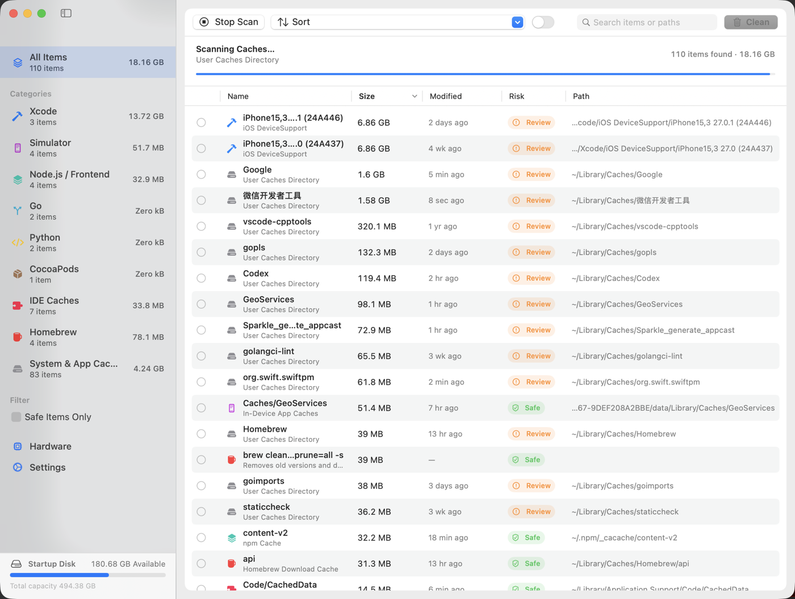

<div align="center">


# Mackit

**Очиститель кэша разработчика для macOS** — просканируйте все восстановимые кэши, которые оставляет после себя ваш инструментарий, выбирайте элементы по одному с понятными метками риска и верните себе место на диске.

[](https://www.apple.com/macos/)
[](https://www.swift.org/)
[](LICENSE)
[](https://github.com/virskor/mackit/releases)
[](https://github.com/virskor/mackit/releases)

[Русский](README_RU.md) · [English](README.md) · [简体中文](README_ZH.md) · [繁體中文](README_ZH_HANT.md) · [한국어](README_KO.md) · [日本語](README_JA.md) · [Español](README_ES.md) · [Français](README_FR.md)

🌐 [Официальный сайт](https://www.mingcui.cn) · ⬇️ [Скачать](https://www.mingcui.cn/download/mackit)

</div>

---

## Зачем нужен Mackit

Go, Node, Yarn, pnpm, Dart, Flutter, Rust, Python, CocoaPods, Gradle, Xcode, Android Studio… каждый из этих инструментов оставляет на вашей машине **восстановимые кэши**: загруженные пакеты, промежуточные результаты сборки, кэши модулей, данные симуляторов, индексы инструментов. По отдельности они не выглядят большими; вместе они суммируются в десятки гигабайт. А в Finder они спрятаны в десятке точечных директорий, где нельзя ни увидеть их размер, ни безопасно удалить их.

Что делает Mackit:

1. **Сканирует** — параллельно перебирает 60+ правил, чтобы найти кэши, артефакты сборки и оставшиеся файлы, где бы они ни находились, и сразу же передаёт результаты в поток, поэтому размеры появляются ещё во время сканирования;
2. **Размечает** — каждый элемент имеет уровень риска (Безопасно / Требует внимания / Осторожно) и полный путь, чтобы вы знали, что произойдёт до удаления;
3. **Позволяет выбирать** — по умолчанию ничего не отмечено; вы выбираете элементы по одному или сразу отмечаете все «безопасные» элементы;
4. **Удаляет** — перемещает в Корзину (обратимо) или удаляет безвозвратно; для консольных элементов вызываются собственные команды очистки инструментов.

## Возможности

- **Сканирование в одно нажатие**: 77 правил для путей + 13 правил очистки из командной строки, результаты которых потоково выводятся в список ещё до завершения сканирования
- **Три уровня риска**: `Безопасно` (чистый кэш, который инструмент воссоздаёт сам) / `Требует внимания` (потребуется повторная загрузка или пересборка) / `Осторожно` (Корзина, резервные копии iOS и т. п. — требуется дополнительное подтверждение)
- **Удаление приложений**: инструментальная страница (раздел «Инструменты» в боковой панели), которая показывает установленные приложения из `/Applications` и `~/Applications` вместе с их остаточными файлами в `~/Library` (поддержка приложений, кэши, контейнеры, настройки, элементы входа…), позволяя удалить приложение вместе с остаточными файлами или очистить только остаточные файлы; работающие приложения отклоняются
- **Очистка мусора приложений**: сканирование очистки охватывает восстановимую часть остаточных файлов приложений (кэши, сетевые хранилища, данные WebKit, журналы, отчёты о сбоях) в строке «Мусор приложений» общего модуля — по каждому приложению отдельно, поэтому кэши одного приложения можно сохранить, очистив остальные
- **Сканирование артефактов сборки**: укажите директорию (например, `~/Projects`), чтобы найти `node_modules`, `build`, `Pods`, `.dart_tool`, `DerivedData`, `target`, `.venv` и другие папки, которые можно пересобрать
- **Очистка из командной строки**: `go clean -cache`, `npm cache clean`, `brew cleanup`, `dart pub cache clean` и т. д.
- **Панель в строке меню**: постоянно находящийся в строке меню значок открывает панель с освобождаемым местом, загрузкой процессора / памяти / температурой, рейтингом использования памяти по приложениям с освобождением памяти в одно нажатие, свободным местом на диске и графиком загрузки процессора
- **Плавающее окно со статистикой на рабочем столе**: необязательная панель, всегда поверх остальных окон, компактно показывающая загрузку процессора / памяти / температуру, читаемая на любых обоях, перетаскиваемая с запоминанием положения и существующая только в процессе агента в строке меню
- **Анализ дискового пространства**: инструментальная страница (раздел «Инструменты» в боковой панели, под пунктами очистки), отвечающая на вопрос «куда ушло место» — переход по «хлебным крошкам» с загрузочного диска, рекурсивный размер каждой папки и древовидная карта (treemap) распределения выбранной папки
- **Информация об оборудовании**: модель, диски, батарея и другая статическая информация
- **Нативный интерфейс**: боковая панель + таблица + панель инструментов на SwiftUI с нативными контекстными меню, горячими клавишами, поиском и заголовками столбцов, сортируемыми по нажатию
- **Локализация**: упрощённый китайский / английский / традиционный китайский / корейский / японский / русский / испанский / французский, по умолчанию следует языку системы
- **Предохранители**: встроенный список защищённых путей; системные директории и связка ключей всегда отклоняются

## Скриншот



> Скриншоты панели в строке меню, плавающего окна на рабочем столе и страницы оборудования появятся позже.

## Установка

### Скачайте готовый бинарник (рекомендуется)

⬇️ [Скачать Mackit](https://www.mingcui.cn/download/mackit)

Возьмите последний DMG-образ из раздела [Releases](https://github.com/virskor/mackit/releases), откройте его и перетащите Mackit в «Программы».

- Универсальный бинарник (arm64 + x86_64) для компьютеров Mac как на Apple silicon, так и на Intel
- Требуется macOS 14 или новее (машины на Intel должны поддерживать macOS 14)
- Первая установка — через DMG; дальнейшие обновления — через встроенное автообновление Sparkle

### Сборка из исходного кода

Требуется macOS 14+ и Xcode 16+ (Swift 6):

```bash
git clone https://github.com/virskor/mackit.git
cd mackit

# Вариант 1: собрать и запустить в один шаг (debug, самая быстрая итерация)
./run.sh

# Вариант 2: собрать релизный Mackit.app, затем запустить
Scripts/build-app.sh release
open Mackit.app
```

Вы также можете открыть `Package.swift` в Xcode и запустить схему `Mackit`. Сборочные версии для разработки компилируются только под родную архитектуру; распространяемый универсальный бинарник (arm64 + x86_64) описан в [примечаниях к выпуску](docs/RELEASE.md).

Запустите тесты:

```bash
swift test
```

## Использование

1. При первом запуске сканирование выполняется автоматически; **по умолчанию ничего не отмечено** — что удалять, решаете вы
2. Просматривайте по категориям в боковой панели или ищите элементы / пути с панели инструментов
3. Добавьте корневые директории своего кода в «Настройки › Каталоги проектов», чтобы сканировать артефакты сборки вроде `node_modules`
4. Чтобы удалить приложение: откройте инструмент «Удаление приложений» в разделе «Инструменты» боковой панели, отметьте приложение (или разверните строку, чтобы отметить отдельные остаточные файлы), и подтвердите
5. Отметив элементы, нажмите «Очистить X ГБ» на панели инструментов; панель подтверждения перечисляет подробности и примечания о рисках
6. Оставьте «Перемещение в Корзину» включённым и очищайте Корзину только тогда, когда вы уверены

Горячие клавиши:

| Сочетание | Действие |
| --- | --- |
| `⌘R` | Повторное сканирование |
| `⌘⌫` | Очистить выбранное |
| `⌘⌥S` | Выбрать все безопасные элементы |
| `⌘,` | Настройки |

## Охват

| Категория | Содержимое |
| --- | --- |
| Артефакты сборки | node_modules, build, Pods, .gradle, .dart_tool, DerivedData, dist, target, .venv, __pycache__ и т. п. |
| Xcode | DerivedData, Archives, DeviceSupport для iOS/watchOS, DocumentationCache, кэши модулей |
| Симуляторы | кэши dyld, кэши приложений на устройстве, временные директории устройств, журналы симуляторов |
| Java | кэши Gradle, дистрибутивы оболочек (wrapper), журналы демонов, JDK Gradle, репозиторий Maven |
| Android | кэши Android SDK, кэши Android Studio, Kotlin/Native |
| Node / фронтенд | npm `_cacache`, Yarn, хранилище pnpm, Bun, node-gyp, TypeScript, ESLint, Deno |
| Flutter / Dart | pub-cache (hosted / git / temp), Dart Analysis Server |
| Go | кэш go-build, кэш загрузки модулей |
| Rust | кэш и исходники реестра cargo, git-зависимости |
| Python | pip, uv, Poetry, кэши pre-commit |
| Ruby | кэш спецификаций RubyGems, установленные пользователем gem'ы, кэш Bundler |
| PHP | кэш Composer |
| .NET | глобальные пакеты NuGet, кэш HTTP |
| Scala / JVM | кэш Coursier, загрузочные файлы sbt, кэш Ivy |
| Haskell | кэш пакетов Cabal и хранилище сборки, инструментальные цепочки и снимки Stack |
| Clojure | git-библиотеки tools.deps, установка Leiningen |
| Elixir / Erlang | кэш реестра Hex, архивы Mix, кэш rebar3 |
| Lua | дерево LuaRocks |
| Julia | кэш прекомпиляции, реестры, установленные пакеты |
| OCaml | кэш загрузок opam, индекс пакетов |
| Zig | глобальный кэш компилятора |
| Nim | кэш компилятора, пакеты Nimble |
| Crystal | кэш компилятора |
| Perl | исходники CPAN, остатки сборки |
| CocoaPods | кэш CocoaPods, кэш Carthage, репозитории спецификаций |
| IDE | кэши и журналы JetBrains, VS Code / Cursor |
| Homebrew | кэш загрузок |
| Система и приложения | `~/Library/Caches`, кэши приложений в песочнице, журналы, отчёты о сбоях, резервные копии iOS |
| Корзина | файлы в `~/.Trash` |

Элементы очистки из командной строки сгруппированы под категорией своего инструмента и показаны рядом с соответствующими правилами для путей.

### Удаление приложений

Удаление приложений — это собственная инструментальная страница в разделе «Инструменты» боковой панели, а не часть сканирования очистки: страница перечисляет все установленные приложения с их настоящим значком, версией, размером и количеством остаточных файлов; по одной строке на приложение с трёхпозиционным флажком — отметка выбирает пакет приложения и все его остаточные файлы сразу, а развёртывание строки показывает каждый остаточный файл со своим флажком, поэтому один кэш или файл настроек можно сохранить или удалить по отдельности. Нажатие правой кнопкой на строке приложения предлагает два быстрых действия:

- **Удалить вместе с остаточными файлами…**: отмечает само приложение плюс все его остаточные файлы и открывает подтверждение
- **Очистить только остаточные файлы…**: очищает остаточные файлы, сохраняя приложение

Удаление переиспользует единый процесс очистки: и приложение, и его остаточные файлы следуют настройке «Настройки › Способ очистки» — перемещение в Корзину (обратимо) или удаление безвозвратно. Работающие приложения отклоняются, с примечанием в результате с просьбой сначала закрыть их; панель подтверждения называет их заранее. Остаточные файлы размечены по месту расположения — кэши и журналы это «Безопасно»; поддержка приложений, настройки, контейнеры и другие места, которые могут содержать пользовательские данные, — «Требует внимания».

Если отмечено только само приложение, панель подтверждения указывает, сколько связанных файлов осталось неотмеченными (количество и размер для каждого приложения), и предлагает быструю команду «Выбрать все», чтобы вы не остались с пустой оболочкой директории, а кэши так и остались на диске.

То, что сканирование очистки сохраняет от мира приложений, — это восстановимая половина: строка «Мусор приложений» общего модуля очищает кэши, сетевые хранилища, данные WebKit, журналы и отчёты о сбоях по каждому приложению — мусор, который приложение воссоздаёт по требованию, — поэтому это место можно освободить, ничего не удаляя, и данные приложений недостижимы из сканирования очистки.

Известные ограничения: групповые контейнеры (Group Containers) (требуют чтения прав доступа каждого приложения), встроенные в приложения деинсталляторы и системные LaunchAgents/демоны (нужны права администратора) не охватываются; приложения, установленные в нестандартные расположения, обнаруженные полным сканированием Spotlight, также вне области действия.

## Разрешения

Mackit требуется читать `~/Library`, `~/.pub-cache`, `~/.gradle`, `/Applications` и подобные места, поэтому **песочница приложений не включена**. Некоторые пути в `~/Library` требуют Полного доступа к диску, который пользователь может выдать вручную в «Системные настройки › Конфиденциальность и безопасность › Полный доступ к диску». Открытие пути в Terminal запрашивает разрешение Apple Events на управление Terminal (`NSAppleEventsUsageDescription`). «Освободить память» на панели в строке меню запрашивает авторизацию администратора и запускает `purge` (сбрасывает файловый кэш; не влияет на память, которую удерживают сами приложения). Инструмент анализа диска намеренно не заходит в `~/Documents`, `~/Desktop` или `~/Downloads` во время сканирования — их перечисление вызывает системный диалог доступа, — поэтому эти папки показаны как «не просканированы» и могут быть просканированы по требованию (одно нажатие или Полный доступ к диску для полного сканирования). Загрузка процессора, памяти и памяти по приложениям берётся из общедоступных системных интерфейсов (`host_statistics64`, `proc_pid_rusage`); в macOS нет общедоступного API температуры, поэтому показанная температура — это системное тепловое состояние. В «Настройки › Общие» есть раздел «Разрешения», который сообщает состояние каждого из них в реальном времени — выдано или нет, что оно открывает, и кнопку, открывающую точную нужную строку настроек (или, для разрешения на автоматизацию, которое приложение никогда не запрашивало, запрашивает его у системы — macOS перечисляет приложение в панели «Автоматизация» только после того, как приложение попросит), — поэтому функция, которая выглядит сломанной, может быть за одно нажатие прослежена до стоящего за ней разрешения.

## Разработка

### Архитектура: главное приложение + агент в строке меню

Mackit — это два процесса из одного бинарника, поставляемые в двух пакетах, которые меняют роли по идентификатору пакета:

| | Mackit.app (`cn.mingcui.mackit`) | MackitAgent.app (`cn.mingcui.mackit.agent`) |
| --- | --- | --- |
| Форма | обычное приложение, есть значок в Dock | LSUIElement, только строка меню |
| Роль | главное окно, сканирование, очистка, настройки, обновления Sparkle | значок и панель в строке меню, плавающее окно со статистикой, наблюдение за системой |
| Жизненный цикл | завершается при закрытии окна | постоянно работает; элемент входа запускает его при входе в систему |

**Закрытие главного окна = выход главного процесса = исчезновение значка в Dock, при этом наблюдение из строки меню продолжает тикать каждую минуту** — именно так реализовано поведение «окно закрыто, но агент жив», без какого-либо переключения политики активации во время выполнения (переключение между обычным режимом и аксессуаром во время выполнения заставляет macOS перестраивать строку меню и каждый раз добавлять/удалять плитки Dock, — именно поэтому строка меню мерцает, а ряд Dock съезжает).

Как сотрудничают два процесса (`Sources/Mackit/IPC/`):

- **Команды**: агент посылает распределённые уведомления (открыть окно / настройки / оборудование / очистка / выход / всплывающее уведомление); если главное приложение не запущено, команды сначала сохраняются на диск и воспроизводятся после его запуска (компенсация холодного старта)
- **Состояние**: главное приложение рассылает агенту состояние сканирования / очистки, чтобы заголовок панели мог показать «освобождаемый размер» и количество отмеченных элементов; данные наблюдения, в свою очередь, опрашиваются только агентом — он должен продолжать тикать после выхода главного приложения
- **Настройки**: общий файл `~/Library/Application Support/Mackit/shared-settings.plist`, записываемый главным приложением и читаемый агентом, с широковещательным обновлением при изменении. Группы приложений (App Groups) не используются: при ad-hoc подписи групповой контейнер разрешить нельзя (cfpregs сообщает `Container: (null)`, и весь источник отсоединяется), что восстанавливается только платной подписью Developer ID — итерации разработки не должны зависеть от сертификата
- **Элемент входа**: регистрирует агент (`SMAppService.loginItem`), поэтому при входе в систему появляется только значок в строке меню; главное приложение перезапускает агента, если он пропал, и присматривает за ним каждые 30 секунд во время работы (агент в строке меню самовосстанавливается после сбоя)
- **Единственный экземпляр**: на каждый идентификатор пакета допускается только один агент — регистрация элемента входа заставляет launchd поднять его в то же мгновение, поэтому, если главное приложение уже запустило своего, появились бы два значка в строке меню; более поздний экземпляр уступает, увидев своего предшественника
- **Постоянная работа**: Info.plist агента отключает `NSSupportsAutomaticTermination` / `NSSupportsSuddenTermination`, и при запуске он вызывает `disableAutomaticTermation`

### Совместимость с macOS 14

Нижняя граница — цель компиляции macOS 14: ни один исходник не использует API выше 14.0 (`swift build` сообщает о нуле предупреждений о доступности для цели 14.0). Единственный символ, которому нужна среда выполнения macOS 15.0+, `withTaskGroup(of:returning:isolation:body:)`, компилируется со слабой связью (weak linking) плюс проверкой версии во время выполнения, с откатом на локальную реализацию на 14.x, поэтому отсутствующий символ никогда не разрешается неудачно. Страница оборудования и наблюдение из строки меню используют одни и те же общедоступные интерфейсы и на Apple silicon, и на Intel (`HardwareSampler` изящно деградирует, когда у Intel нет уровней производительности).

### Локализация

Все пользовательские строки живут в `Sources/Mackit/Resources/Localizable.xcstrings` (каталог строк), с упрощённым китайским как исходным языком плюс переводы на английский, традиционный китайский, корейский, японский, русский, испанский и французский. В коде не встречается никаких пользовательских литералов; всё проходит через `Utilities/L10n.swift`:

```swift
Text(verbatim: L10n.tr("toolbar.rescan"))                 // статическая строка
Text(verbatim: L10n.fmt("toast.trashed", item.title))     // с подстановочными значениями: %@ / %lld
Text(verbatim: L10n.items(count))                         // «N элементов», множественное число обрабатывается
```

Чтобы добавить язык: переведите его в каталоге (откройте его в Xcode и нажмите `+` в левом нижнем углу), затем зарегистрируйте его — вариант `AppLanguage` с его самоназванием и сопоставлением с системными настройками в `Utilities/AppLanguage.swift`, язык в обоих массивах `CFBundleLocalizations` в `Scripts/build-app.sh` и, как только он поставляется в интерфейсе, его первичный подтег в `LanguageFileScanner.isWhitelisted`, чтобы правило очистки языковых пакетов его сохраняло. Новые строки добавляются как ключи в каталог; `LocalizationTests` в наборе тестов проверяет полноту ключей и согласованность подстановочных значений по местам вызова.

Выбор языка интерфейса живёт в `Utilities/AppLanguage.swift`: «Следовать системе» плюс восемь языков, хранящиеся в UserDefaults под ключом `appLanguage` и зеркалируемые в `AppleLanguages` домена приложения — поиск строк CFBundle читает этот ключ, поэтому изменение вступает в силу после перезапуска (интерфейс обновления Sparkle и системные файловые панели следуют за ним). Почему перезапуск, а не переключение внутри процесса: заголовки и описания результатов сканирования заморожены на текущем языке в момент создания, поэтому обновление внутри процесса дало бы только список со смешанными языками (подробности см. в комментариях исходного кода).

### Ведение журнала

События жизненного цикла (начало, завершение, отмена, сбой сканирования / очистки) и изменения формы окна проходят через единый `os.Logger` (подсистема = идентификатор пакета), записываются и в релизных сборках. Каждый процесс ведёт журнал в своей подсистеме: `cn.mingcui.mackit` для главного приложения, `cn.mingcui.mackit.agent` для агента в строке меню. Смотрите в реальном времени:

```bash
log stream --predicate 'subsystem == "cn.mingcui.mackit"' --level info
# журналы агента в строке меню (запуск, перезапуск, присмотр)
log stream --predicate 'subsystem == "cn.mingcui.mackit.agent"' --level info
# подробности перечисления по каждой директории (какие недоступные директории были пропущены): добавьте --level debug
```

Фильтруйте по подсистеме в приложении «Консоль». Записываются только количества, размеры, длительности и идентификаторы правил — никогда содержимое файлов.

### Структура проекта

```
Sources/Mackit/
├── MackitApp.swift               # диспетчеризация входа (@main переключает роль по идентификатору пакета) + главное окно/меню + общий AppDelegate
├── AgentApp.swift                # вход агента в строке меню (MenuBarExtra + метки)
├── Models/                       # модели данных: элементы, категории, уровни риска, правила сканирования, компараторы
├── Engine/
│   ├── RulesCatalog.swift        # 77 правил сканирования и 13 команд очистки из CLI
│   ├── AppScanner.swift          # обнаружение установленных приложений и остаточных файлов (питает инструмент удаления и строку мусора приложений)
│   ├── FileSystem.swift          # вычисление размера, сопоставление с шаблоном, поиск инструментов, ёмкость тома
│   ├── Scanner.swift             # параллельное сканирование + обход директорий проектов
│   ├── DiskAnalyzer.swift        # анализ дискового пространства: перечисление по каждой директории + рекурсивное измерение
│   ├── TreemapLayout.swift       # раскладка squarified treemap (чистая функция)
│   └── Cleaner.swift             # удаление / корзина / выполнение команд
├── Monitor/                      # сбор загрузки процессора / памяти / температуры, информация об оборудовании, освобождение памяти
├── IPC/                          # межпроцессные каналы команд / состояния / настроек (распределённые уведомления + общий plist)
├── Updater/
│   └── UpdateController.swift    # автообновление Sparkle
├── ViewModels/
│   ├── AppViewModel.swift        # конечный автомат: сканирование, выбор, очистка, настройки (по одному на процесс)
│   ├── DiskAnalysisModel.swift   # страница анализа диска: навигация, потоковое измерение, кэш
│   ├── HomebrewModel.swift       # страница менеджера Homebrew: снимок, разделы, действия, поиск
│   └── AppUninstallModel.swift   # страница удаления приложений: список приложений, выбор, процесс удаления
├── Views/                        # SwiftUI: главное окно, панель в строке меню, плавающее окно, настройки, оборудование, анализ диска
│   └── Components/               #   переиспользуемые компоненты (значки, кольцо прогресса, строки уведомлений, потоковая раскладка…)
└── Utilities/
    ├── AppLanguage.swift         # выбор языка интерфейса (система + восемь языков, записывает AppleLanguages)
    ├── MackitLog.swift           # единая обёртка над os.Logger
    ├── Formatters.swift          # форматирование байтов и времени
    ├── LaunchAtLogin.swift       # регистрация элемента входа (указывает на встроенный MackitAgent.app)
    └── L10n.swift                # поиск локализации (каталог строк)
    Resources/
    ├── Localizable.xcstrings     # восемь языков (zh-Hans / en / zh-Hant / ko / ja / ru / es / fr)
    └── sparkle-blue.png          # фирменный значок (общий для отображения в приложении и значка приложения)
Scripts/                          # скрипты сборки / упаковки / генерации значков
Tests/MackitTests/                # 52 файла тестов
```

### Тесты

`swift test`. 52 файла тестов покрывают движок сканирования, движок очистки, каталог правил, удаление приложений, сканирование мусора приложений, общее хранилище, компараторы сортировки, целостность ключей локализации, контроллер обновлений и многое другое.

### Выпуск

Подписание, нотаризация, упаковка DMG и конвейер обновлений Sparkle предназначены для сопровождающих; см. [docs/RELEASE.md](docs/RELEASE.md).

## Участие в проекте

Баги и пул-реквесты приветствуются. Сборка, тесты и соглашения о коде: [CONTRIBUTING.md](CONTRIBUTING.md). Участвуя, вы соглашаетесь соблюдать [кодекс поведения](CODE_OF_CONDUCT.md).

## Безопасность

Личные ключи, сертификаты и учётные данные **никогда не попадают в репозиторий**: `secrets/` и все файлы `*.p8` / `*.pem` / `*.key` блокируются `.gitignore`, а хук pre-commit (устанавливается через `Scripts/install-git-hooks.sh`) сканирует область подготовки, чтобы перехватить личные ключи. Пожалуйста, не открывайте публичные issue для проблем безопасности — сообщайте о них конфиденциально через GitHub Security Advisory.

## Лицензия

[MIT](LICENSE) © 2026 virskor

## Благодарности

- [Sparkle 2](https://sparkle-project.org/) — встроенное автообновление
