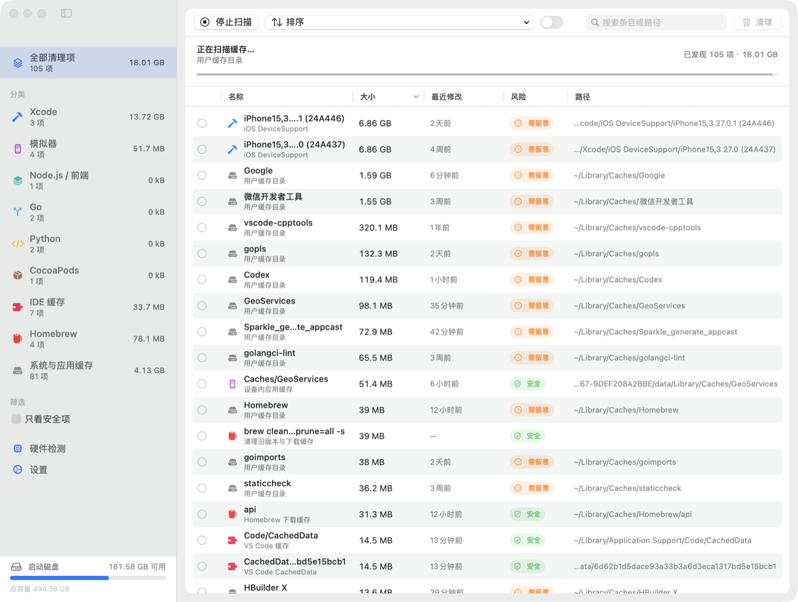

<div align="center">


# Mackit

**macOS 開發快取清理工具** — 把工具鏈留下的可再生快取統一掃出來，逐項勾選、標註風險，把磁碟空間拿回來。

[](https://www.apple.com/macos/)
[](https://www.swift.org/)
[](LICENSE)
[](https://github.com/virskor/mackit/releases)
[](https://github.com/virskor/mackit/releases)

[繁體中文](README_ZH_HANT.md) · [简体中文](README_ZH.md) · [English](README.md) · [한국어](README_KO.md) · [日本語](README_JA.md)

🌐 [官方網站 / 落地頁](https://www.mingcui.cn)

</div>

---

## 為什麼有 Mackit

Go、Node、Yarn、pnpm、Dart、Flutter、Rust、Python、CocoaPods、Gradle、Xcode、Android Studio…… 這些工具運行時都會在本地留下大量**可再生的快取**：包下載快取、建置中間產物、模組快取、模擬器資料、工具索引。單個看不佔多少，日積月累就是幾十 GB；而它們在 Finder 裡散落在十幾處隱藏目錄，既看不出體積，也不敢隨便刪。

Mackit 做的事情：

1. **掃** — 並行枚舉 77 條路徑規則，把散落各處的快取、建置產物、殘留文件統一找出來，流式回報，掃描同時就能看到體積；
2. **標** — 每一項標註風險等級（安全 / 需留意 / 謹慎）與完整路徑，刪之前就知道會發生什麼；
3. **選** — 預設一個都不勾，由你逐項決定，也可以一鍵全選所有"安全"項；
4. **刪** — 移入廢紙簍（可恢復）或直接徹底刪除；命令列條目調用工具自帶的清理命令。

## 功能

- **一鍵掃描**：77 條路徑規則 + 13 條命令列清理規則，掃描進行中就流式填入列表
- **三級風險**：`安全`（純快取，工具會自己重建）/ `需留意`（需要重新下載或重新建置）/ `謹慎`（廢紙簍、iOS 備份等，需額外確認）
- **應用卸載**：側邊欄"工具"分區中的工具頁，列出 `/Applications` 與 `~/Applications` 已安裝應用，連同 `~/Library` 下的殘留（應用支援、快取、容器、偏好設定、登錄項……），可連同殘留一起卸載，也可只清理殘留；正在運行的應用會被拒絕
- **建置產物掃描**：指定一個目錄（如 `~/Projects`），找出 `node_modules`、`build`、`Pods`、`.dart_tool`、`DerivedData`、`target`、`.venv` 等可重建目錄
- **命令列清理**：`go clean -cache`、`npm cache clean`、`brew cleanup`、`dart pub cache clean` 等
- **通用清理**：面向日常使用的獨立模組——瀏覽器快取（Chrome 家族、Chromium、Edge、Brave、Arc、Opera、Firefox、QQ 瀏覽器）、應用包內無用的語言文件（`LanguageFileScanner`，只整目錄刪除 `.lproj` 以保證程式碼簽名有效，白名單保留中文任意變體、英文與 Base）、`~/Downloads` 裡的安裝包與壓縮包；規則行按系統垃圾 / 瀏覽垃圾分組，預設勾到"推薦"為止，"謹慎"行（廢紙簍、下載的安裝包、iOS 備份）需自行勾選
- **快取免卸載清理**：殘留掃描按內容拆分——可再生的垃圾（快取、HTTP 儲存、WebKit 資料、日誌、崩潰報告）歸入通用模組的應用垃圾行，按應用分組，可保留單個應用的快取只掃其餘；資料（偏好設定、應用支援、容器、cookies）隨應用走卸載工具，刪除它們是使用者的明確意圖
- **選單列面板**：常駐選單列圖示，點開即可看可清理空間、CPU / 記憶體 / 溫度、按記憶體排序的應用列表（一鍵"釋放記憶體"）、剩餘磁碟空間與 CPU 曲線
- **桌面懸浮狀態列**：可選的常駐置頂條，緊湊顯示 CPU / 記憶體 / 溫度，任意桌布下都清晰可讀，可拖曳並記憶位置，只存在於托盤程序
- **磁碟空間分析**：側邊欄"工具"分區（清理條目下方）的工具頁，回答"空間都去哪了"——從啟動磁碟逐層下鑽，每個資料夾的遞歸體積，以及所選資料夾構成的 treemap
- **硬體資訊**：機型、磁碟、電池等靜態資訊
- **原生介面**：SwiftUI 側邊欄 + 表格 + 工具欄，原生右鍵選單、快捷鍵、搜尋與點擊排序的表頭
- **本地化**：簡體中文 / 英文 / 繁體中文 / 韓語 / 日語，預設跟隨系統語言
- **安全護欄**：內建受保護路徑清單；系統目錄與鑰匙串一律拒絕

## 螢幕截圖



> 選單列面板、桌面懸浮條與硬體資訊頁的螢幕截圖待補。

## 安裝

### 下載預編譯版本（推薦）

從 [Releases](https://github.com/virskor/mackit/releases) 取最新的 DMG，打開後把 Mackit 拖進"應用程式"。

- 通用二進位（arm64 + x86_64），Apple 晶片與 Intel Mac 通吃
- 需要 macOS 14 或更高版本（Intel 機型須能運行 macOS 14）
- 首次安裝走 DMG；之後的更新走 App 內 Sparkle 自動更新

### 從原始碼建置

需要 macOS 14+ 與 Xcode 16+（Swift 6）：

```bash
git clone https://github.com/virskor/mackit.git
cd mackit

# 方式一：一步建置並啟動（debug，迭代最快）
./run.sh

# 方式二：建置 release 版 Mackit.app，再啟動
Scripts/build-app.sh release
open Mackit.app
```

也可以在 Xcode 裡打開 `Package.swift` 運行 `Mackit` scheme。開發建置只編譯當前原生架構；可發布的通用二進位（arm64 + x86_64）見[發布說明](docs/RELEASE.md)。

運行測試：

```bash
swift test
```

## 使用

1. 首次啟動會自動掃描；**預設一個都不勾**——刪什麼由你決定
2. 在側邊欄按分類瀏覽，或從工具欄搜尋專案 / 路徑
3. 在"設定 › 專案目錄"下添加你的程式碼根目錄，即可掃描 `node_modules` 等建置產物
4. 卸載應用：打開側邊欄"工具"分區的"應用卸載"，勾選應用（或展開該行單獨勾選殘留文件）後確認
5. 勾選後點擊工具欄的"清理 X GB"；確認面板會列出明細與風險說明
6. 保持"移入廢紙簍"開啟，確認無誤後再清空廢紙簍

快捷鍵：

| 快捷鍵 | 作用 |
| --- | --- |
| `⌘R` | 重新掃描 |
| `⌘⌫` | 清理所選 |
| `⌘⌥S` | 全選安全項 |
| `⌘,` | 設定 |

## 覆蓋範圍

| 分類 | 內容 |
| --- | --- |
| 建置產物 | node_modules、build、Pods、.gradle、.dart_tool、DerivedData、dist、target、.venv、__pycache__ 等 |
| Xcode | DerivedData、Archives、iOS/watchOS DeviceSupport、DocumentationCache、模組快取 |
| 模擬器 | dyld 快取、設備內應用快取、設備臨時目錄、模擬器日誌 |
| Android / Gradle | Gradle 快取、wrapper 發行包、常駐程式日誌、Android Studio 快取、Kotlin/Native、Maven 倉庫 |
| Node / 前端 | npm `_cacache`、Yarn、pnpm store、Bun、node-gyp、TypeScript、ESLint、Deno |
| Flutter / Dart | pub-cache（hosted / git / temp）、Dart Analysis Server |
| Go | go-build 快取、模組下載快取 |
| Rust | cargo registry 快取/src、git 依賴 |
| Python | pip、uv、Poetry、pre-commit 快取 |
| Ruby | RubyGems 規格快取、使用者級 Gem、Bundler 快取 |
| PHP | Composer 快取 |
| .NET | NuGet 全域包、HTTP 快取 |
| Scala / JVM | Coursier 快取、sbt 啟動目錄、Ivy 快取 |
| Haskell | Cabal 包快取與建置儲存、Stack 工具鏈與快照 |
| Clojure | tools.deps git 依賴、Leiningen 主程序 |
| Elixir / Erlang | Hex 註冊表快取、Mix 歸檔、rebar3 快取 |
| Lua | LuaRocks 安裝目錄 |
| Julia | 預編譯快取、註冊表、已安裝包 |
| OCaml | opam 下載快取、包索引 |
| Zig | 編譯器全域快取 |
| Nim | 編譯快取、Nimble 包 |
| Crystal | 編譯器快取 |
| Perl | CPAN 下載源、建置殘留 |
| CocoaPods | CocoaPods 快取、Carthage 快取、spec 倉庫 |
| IDE | JetBrains、VS Code / Cursor 的快取與日誌 |
| Homebrew | 下載快取 |
| 系統與應用 | `~/Library/Caches`、沙盒應用快取、日誌、崩潰報告、iOS 備份 |
| 廢紙簍 | `~/.Trash` 中的文件 |

命令列清理條目歸入對應工具的分類，與相應的路徑規則並列展示。

### 應用卸載

應用卸載是側邊欄"工具"分區中獨立的工具頁，不再是清理掃描的一部分：頁面列出每個已安裝應用，顯示真實圖示、版本、體積、殘留文件數；每個應用一行，帶三態核取方塊——勾選即同時選中應用本體與全部殘留文件，展開該行則顯示每個殘留文件各自的核取方塊，可單獨保留或刪除某一個快取或偏好設定。右鍵應用行提供兩個快捷操作：

- **連同殘留文件卸載…**：勾選應用本身及其全部殘留文件，並打開確認
- **僅清理殘留文件…**：只清理殘留，保留應用

卸載複用統一的清理流程：應用與殘留文件都遵循"設定 › 清理方式"的設定——移入廢紙簍（可恢復）或直接刪除。正在運行的應用會被拒絕，並在結果中提示你先退出；確認面板會提前列出它們的名字。殘留文件按位置標註風險——快取與日誌為"安全"；應用支援、偏好設定、容器等可能存有使用者資料的位置為"需留意"。

若只勾選應用本身，確認面板會提示每個應用還有多少關聯文件未勾選（數量與體積），並提供"全選"快捷操作，避免最後只剩一個空目錄、快取還留在磁碟上。

清理掃描保留的是應用世界中可再生的那一半：通用模組的"應用垃圾"行按應用分組清理快取、HTTP 儲存、WebKit 資料、日誌與崩潰報告——都是應用按需重建的垃圾——不卸載任何東西也能釋放這部分空間，且清理掃描永遠夠不到應用資料。

已知限制：Group Containers（需要讀取各應用的 entitlement）、應用自帶的卸載程序與系統級 LaunchAgents/Daemons（需要管理員權限）不在覆蓋範圍內；通過完整 Spotlight 掃描發現的自定義位置安裝的應用也不在範圍內。

## 權限

Mackit 需要讀取 `~/Library`、`~/.pub-cache`、`~/.gradle`、`/Applications` 等位置，因此**未啟用 App Sandbox**。`~/Library` 下的部分路徑需要"完全磁碟訪問權限"，可在"系統設定 › 隱私與安全性 › 完全磁碟訪問權限"中手動授予。在終端機中打開路徑會請求控制終端機的 Apple Events 權限（`NSAppleEventsUsageDescription`）。托盤面板的"釋放記憶體"會請求管理員授權並執行 `purge`（丟棄文件快取，不影響應用自身佔用的記憶體）。磁碟空間分析工具在掃描時刻意不進入 `~/Documents`、`~/Desktop`、`~/Downloads`——枚舉它們會彈出系統訪問對話框——這些資料夾會被列為"未掃描"，可按需掃描（點一下，或授予完全磁碟訪問權限以完整掃描）。CPU、記憶體與各應用記憶體來自公開系統接口（`host_statistics64`、`proc_pid_rusage`）；macOS 沒有公開的溫度接口，所示溫度為系統熱狀態。「設定 › 通用」中的「權限管理」一欄實時報告上述每一項——是否已授予、解鎖哪些功能、以及直達對應設定行的按鈕（對從未請求過的自動化授權，則先向系統發起請求：macOS 只把“問過”的應用列進自動化列表）——某個功能表現異常時，可以一次點擊定位到背後的權限。

## 開發

### 架構：主 App + 托盤代理

Mackit 是同一份二進位裡的兩個程序，打成兩個 bundle，通過 bundle ID 切換角色：

| | Mackit.app（`cn.mingcui.mackit`） | MackitAgent.app（`cn.mingcui.mackit.agent`） |
| --- | --- | --- |
| 形態 | 常規應用，有 Dock 圖示 | LSUIElement，只有選單列 |
| 職責 | 主視窗、掃描、清理、設定、Sparkle 更新 | 選單列圖示與面板、桌面狀態列、系統監控 |
| 生命周期 | 關窗即退出 | 常駐；登錄項在登錄時啟動 |

**關掉主視窗 = 主程序退出 = Dock 圖示消失，而選單列監控照常每分鐘走一次**——"視窗關了但托盤還在"就是這樣實現的，全程不做運行時的 activation policy 切換（regular 與 accessory 之間運行時切換會讓 macOS 重建選單列、反復增刪 Dock 磁貼，這正是選單列閃爍、Dock 行串位的原因）。

兩個程序如何協作（`Sources/Mackit/IPC/`）：

- **命令**：代理通過分布式通知下發（打開視窗 / 設定 / 硬體 / 清理 / 退出 / 浮窗提示）；主 App 未運行時，命令先落盤，待其啟動後補發（冷啟動補償）
- **狀態**：主 App 向代理廣播掃描 / 清理狀態，面板頭部因此能顯示"可清理體積"與已勾選數量；監控資料則由代理獨享輪詢——主 App 退出後它仍須繼續走時
- **設定**：共享文件 `~/Library/Application Support/Mackit/shared-settings.plist`，由主 App 寫入、代理讀取，變更時廣播重新整理。不用 App Groups：ad-hoc 簽名下 Group Container 無法解析（cfpregs 報 `Container: (null)`，整個原始碼會被 detach），只有付費 Developer ID 簽名才能恢復——開發迭代不能依賴證書
- **登錄項**：註冊代理（`SMAppService.loginItem`），登錄時只出現選單列圖示；代理缺失時主 App 會重新拉起了它，並在運行期間每 30 秒照看一次（代理崩潰後托盤自愈）
- **單實例**：每個 bundle ID 只允許一個代理——註冊登錄項會讓 launchd 在同一瞬間拉起一個，若主 App 已經起過一個，就會出現兩個托盤圖示；後起的實例見到前輩即退讓
- **常駐**：代理的 Info.plist 關閉 `NSSupportsAutomaticTermination` / `NSSupportsSuddenTermination`，並在啟動時調用 `disableAutomaticTermation`

### macOS 14 相容

底線是編譯目標 macOS 14：沒有任何原始碼使用 14.0 以上的 API（針對 14.0 目標 `swift build` 零可用性警告）。唯一需要 macOS 15.0+ 運行時的符號 `withTaskGroup(of:returning:isolation:body:)` 以弱鏈接加運行時版本檢查的方式編入，在 14.x 上回退到本地實現，因此不會出現符號解析失敗。硬體頁與選單列監控在 Apple 晶片和 Intel 上使用同一套公開接口（Intel 沒有 perf level 時 `HardwareSampler` 會優雅降級）。

### 本地化

所有面向使用者的字串都放在 `Sources/Mackit/Resources/Localizable.xcstrings`（String Catalog），以簡體中文為源語言，另有英文、繁體中文、韓語與日語翻譯。程式碼中不出現面向使用者的字面量，一切都經過 `Utilities/L10n.swift`：

```swift
Text(verbatim: L10n.tr("toolbar.rescan"))                 // 靜態字串
Text(verbatim: L10n.fmt("toast.trashed", item.title))     // 帶佔位符：%@ / %lld
Text(verbatim: L10n.items(count))                         // "N 項"，複數已處理
```

新增語言：先在 catalog 中翻譯（在 Xcode 中打開，點左下角 `+`），再完成註冊——`Utilities/AppLanguage.swift` 中新增枚舉項（自帶文字名與系統語言匹配）、`Scripts/build-app.sh` 兩處 `CFBundleLocalizations` 中加入該語言；該語言隨介面發布後，還要把主子 tag 加入 `LanguageFileScanner.isWhitelisted`，語言包清理規則才會保留它。新字串以鍵的形式加入 catalog；測試套件中的 `LocalizationTests` 會對照調用點檢查鍵完整性與佔位符一致性。

介面語言選擇在 `Utilities/AppLanguage.swift`："跟隨系統"外加五種語言，存於 UserDefaults 的 `appLanguage`，並鏡像進 App 域的 `AppleLanguages`——CFBundle 的字串查找讀這個鍵，因此重啟後生效（Sparkle 的更新介面與系統文件面板也隨之切換）。為什麼是重啟而不是程序內切換：掃描結果的標題與描述在創建時即以當前語言定稿，程序內重新整理只會得到一份中英混雜的列表（詳見原始碼註釋）。

兩個複數鍵（`.one` / `.other`）必須保持相同的佔位符布局——`.one` 也要有 `%lld`，只把名詞換成單數形式；否則 `%@` 會收到整數，介面首次渲染即崩潰。

### 日誌

生命周期事件（掃描 / 清理的開始、完成、取消、失敗）與視窗形態變化統一走 `os.Logger`（subsystem = bundle ID），release 建置同樣記錄。兩個程序各按自己的 subsystem 記錄：主 App 是 `cn.mingcui.mackit`，托盤代理是 `cn.mingcui.mackit.agent`。實時查看：

```bash
log stream --predicate 'subsystem == "cn.mingcui.mackit"' --level info
# 托盤代理日誌（啟動、重啟、照看）
log stream --predicate 'subsystem == "cn.mingcui.mackit.agent"' --level info
# 逐目錄枚舉細節（跳過了哪些不可讀目錄）：加 --level debug
```

在"控制台"App 中按 subsystem 過濾。只記錄數量、體積、耗時與規則 id——絕不記錄文件內容。

### 專案結構

```
Sources/Mackit/
├── MackitApp.swift               # 入口分發（@main 按 bundle ID 切換角色）+ 主視窗/選單 + 共享 AppDelegate
├── AgentApp.swift                # 托盤代理入口（MenuBarExtra + 標簽）
├── Models/                       # 資料模型：專案、分類、風險等級、掃描規則、比較器
├── Engine/
│   ├── RulesCatalog.swift        # 77 條掃描規則與 13 條 CLI 清理命令
│   ├── AppScanner.swift          # 已安裝應用發現與殘留檢測（同時供卸載工具與應用垃圾行）
│   ├── FileSystem.swift          # 體積計算、通配、工具查找、卷容量
│   ├── Scanner.swift             # 並行掃描 + 專案目錄遍歷
│   ├── DiskAnalyzer.swift        # 磁碟空間分析：逐目錄列舉 + 遞歸測量
│   ├── TreemapLayout.swift       # squarified treemap 布局（純函式）
│   └── Cleaner.swift             # 刪除 / 廢紙簍 / 命令執行
├── Monitor/                      # CPU / 記憶體 / 溫度採樣、硬體資訊、記憶體釋放
├── IPC/                          # 程序間命令 / 狀態 / 設定通道（分布式通知 + 共享 plist）
├── Updater/
│   └── UpdateController.swift    # Sparkle 自動更新
├── ViewModels/
│   ├── AppViewModel.swift        # 狀態機：掃描、選擇、清理、設定（每程序一個）
│   ├── DiskAnalysisModel.swift   # 磁碟分析頁：導航、流式測量、快取
│   ├── HomebrewModel.swift       # Homebrew 管理器頁：快照、分區、動作、搜尋
│   └── AppUninstallModel.swift   # 應用卸載頁：應用列表、選擇、卸載流程
├── Views/                        # SwiftUI：主視窗、托盤面板、懸浮條、設定、硬體、磁碟分析
│   └── Components/               #   可複用組件（徽章、進度環、提示行、流式布局……）
└── Utilities/
    ├── AppLanguage.swift         # 介面語言選擇（系統 + 五種語言，寫 AppleLanguages）
    ├── MackitLog.swift           # 統一 os.Logger 封裝
    ├── Formatters.swift          # 字節與時間格式化
    ├── LaunchAtLogin.swift       # 登錄項註冊（指向內建的 MackitAgent.app）
    └── L10n.swift                # 本地化查找（String Catalog）
    Resources/
    ├── Localizable.xcstrings     # 五種語言（zh-Hans / en / zh-Hant / ko / ja）
    └── sparkle-blue.png          # 品牌圖示（App 內展示與應用圖示共用）
Scripts/                          # 建置 / 打包 / 圖示生成腳本
Tests/MackitTests/                # 52 個測試文件
```

### 測試

`swift test`。52 個測試文件覆蓋掃描引擎、清理引擎、規則目錄、應用卸載、應用垃圾掃描、共享儲存、排序比較器、本地化鍵完整性、更新控制器等。

### 發布

簽名、公證、DMG 打包與 Sparkle 更新管線面向維護者，見 [docs/RELEASE.md](docs/RELEASE.md)。

## 貢獻

歡迎 Issue 與 PR。建置、測試與程式碼約定見 [CONTRIBUTING.md](CONTRIBUTING.md)。參與即表示你同意遵守[行為準則](CODE_OF_CONDUCT.md)。

## 安全

私鑰、證書與憑據**絕不進入倉庫**：`secrets/` 與所有 `*.p8` / `*.pem` / `*.key` 文件均被 `.gitignore` 攔截，pre-commit 鉤子（通過 `Scripts/install-git-hooks.sh` 安裝）會掃描暫存區兜底攔截私鑰。請不要為安全問題開公開 Issue——請通過 GitHub Security Advisory 私下報告。

## 許可證

[MIT](LICENSE) © 2026 virskor

## 致謝

- [Sparkle 2](https://sparkle-project.org/) — App 內自動更新
